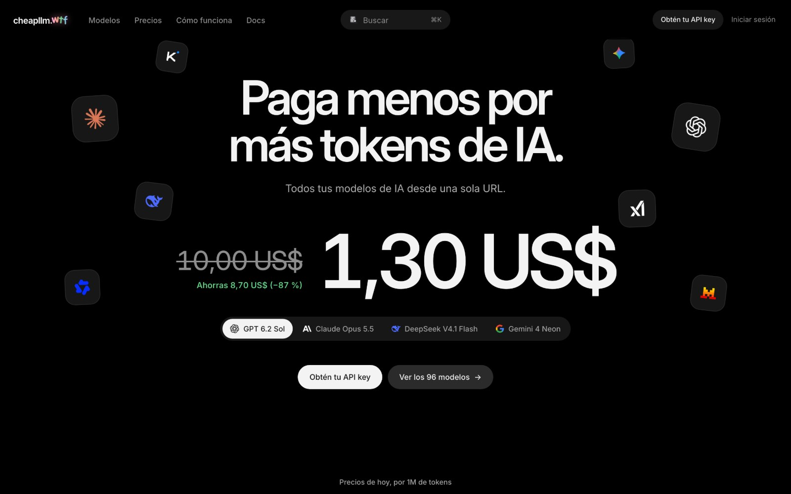
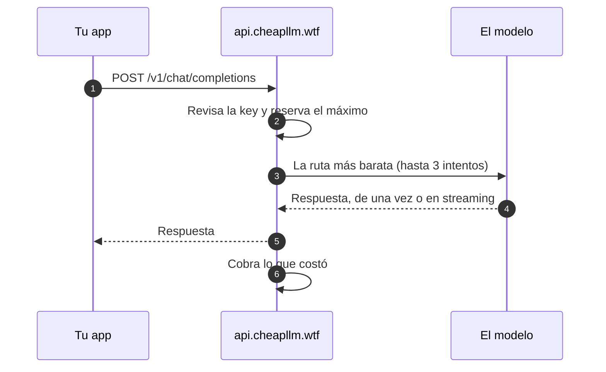
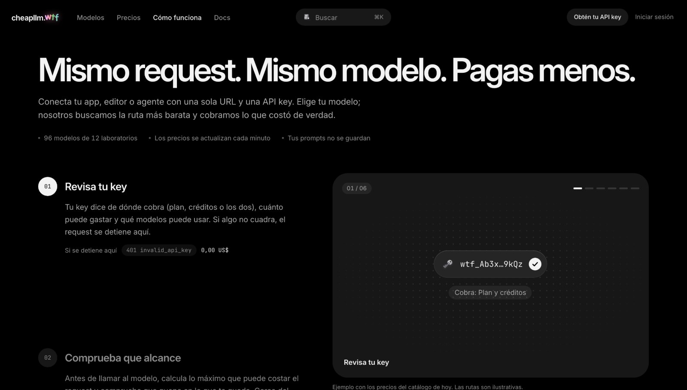

<div align="center">

<h1>cheapllm.wtf</h1>

<p><b>Una URL para todos los modelos de IA, por menos.</b></p>

<p>Gateway compatible con la API de OpenAI. Pides un modelo, el request va por la ruta más barata<br>
de ese momento y se cobra lo que costó, nunca más que el precio publicado.</p>

<p>
   
</p>

<p>
<a href="https://cheapllm.wtf"><b>Sitio</b></a> &nbsp;·&nbsp;
<a href="https://cheapllm.wtf/es/pricing">Precios</a> &nbsp;·&nbsp;
<a href="https://cheapllm.wtf/es/docs">API</a> &nbsp;·&nbsp;
<a href="./docs/README.md">Documentación</a> &nbsp;·&nbsp;
<a href="./docs/adr/README.md">Decisiones</a>
</p>

<br>



<br><br>

<p><sub>LOS MODELOS DE</sub></p>

<p>
<picture><source media="(prefers-color-scheme: dark)" srcset="./docs/readme/logos/anthropic-dark.svg"></picture>&emsp;<picture><source media="(prefers-color-scheme: dark)" srcset="./docs/readme/logos/openai-dark.svg"></picture>&emsp;&emsp;&emsp;&emsp;&emsp;<picture><source media="(prefers-color-scheme: dark)" srcset="./docs/readme/logos/xai-dark.svg"></picture>&emsp;<picture><source media="(prefers-color-scheme: dark)" srcset="./docs/readme/logos/kimi-dark.svg"></picture>&emsp;&emsp;&emsp;<picture><source media="(prefers-color-scheme: dark)" srcset="./docs/readme/logos/zai-dark.svg"></picture>&emsp;
</p>

</div>

<br>

## Qué hace

<table>
  <tr>
    <td width="33%" valign="top">
      <h3>Compatible con OpenAI</h3>
      Cambias la URL base y la key. El SDK, las herramientas y el streaming siguen igual.
    </td>
    <td width="33%" valign="top">
      <h3>El precio es un tope</h3>
      Cada request se cobra a lo que costó de verdad. Si el costo baja, pagas menos. Si falla, no pagas.
    </td>
    <td width="33%" valign="top">
      <h3>La ruta más barata</h3>
      El mismo modelo se sirve a distintos precios. Los precios se revisan cada minuto y, si una ruta falla, se reintenta sola.
    </td>
  </tr>
  <tr>
    <td width="33%" valign="top">
      <h3>Plan, créditos o los dos</h3>
      Planes con un límite cada 5 horas y otro semanal, o créditos por uso que no vencen. Una sola key.
    </td>
    <td width="33%" valign="top">
      <h3>Sin tarjeta</h3>
      Se paga con USDC en Solana o en Base, o con Bitcoin. Sin cobros automáticos ni contracargos.
    </td>
    <td width="33%" valign="top">
      <h3>Sin guardar contenido</h3>
      De cada request queda el modelo, los tokens, el costo y la hora. Nunca los mensajes ni la respuesta.
    </td>
  </tr>
</table>

```python
from openai import OpenAI

client = OpenAI(
    base_url="https://api.cheapllm.wtf/v1",  # antes: https://api.openai.com/v1
    api_key="wtf_...",
)
```

## Cómo viaja un request



Si algo no cuadra antes de llamar al modelo (key, saldo o ruta), el request se detiene con su error y cuesta cero. El detalle de cada paso está en [docs/04 · API](./docs/04-api.md) y en la página [Cómo funciona](https://cheapllm.wtf/es/how-it-works).

## El producto

<table>
  <tr>
    <td width="50%" valign="top">
      
      <br><b>Precios</b><br>
      <sub>Los planes junto a Créditos, con las requests típicas que caben según el modelo.</sub>
    </td>
    <td width="50%" valign="top">
      
      <br><b>Cómo se cobra</b><br>
      <sub>Límites, el reparto entre plan y créditos, el cobro cero si falla y el precio tope.</sub>
    </td>
  </tr>
  <tr>
    <td width="50%" valign="top">
      
      <br><b>Cómo funciona</b><br>
      <sub>Los seis pasos de un request, de la key al cobro, en un recorrido que avanza con el scroll.</sub>
    </td>
    <td width="50%" valign="top">
      
      <br><b>Dashboard</b><br>
      <sub>Los límites del plan, el saldo, el ahorro de la semana y lo que gasta cada modelo.</sub>
    </td>
  </tr>
</table>

<br>

<div align="center">

       

</div>

## Empezar en local

Sin cuentas ni Docker: la base es PGlite y el upstream es el simulado.

```bash
pnpm install
cp .env.example .env.local     # los valores de ejemplo ya funcionan en local

pnpm db:dev                    # terminal 1: Postgres local (PGlite) en 127.0.0.1:5433, datos en .pglite/
pnpm mock:upstream             # terminal 2: upstream simulado en 127.0.0.1:4010

pnpm catalog:sync              # carga catalog/ en la base (db:dev ya aplicó las migraciones)
pnpm dev                       # terminal 3: http://localhost:3000
```

> [!TIP]
> Sin las claves de Clerk, `/es/sign-in` entra en modo de desarrollo: cualquier nombre o correo y cualquier código de seis dígitos. `000000` muestra el error de código incorrecto.

<details>
<summary><b>Probar el gateway con una key</b></summary>

<br>

```bash
pnpm keys:create -- --workspace demo            # imprime la key wtf_ una sola vez
export CHEAPLLM_API_KEY=wtf_...
pnpm credits:grant -- --workspace demo --usd 5 --note "prueba local"

curl http://localhost:3000/v1/chat/completions \
  -H "Authorization: Bearer $CHEAPLLM_API_KEY" \
  -H "Content-Type: application/json" \
  -d '{"model": "qwen/qwen3.8-flash", "messages": [{"role": "user", "content": "Hola"}]}'

pnpm reconcile                 # saldo y gasto de cada key contra los requests, y gasto por upstream
```

- **Contra InferHub de verdad:** pon `UPSTREAM_INFERHUB_API_KEY` en `.env.local`. InferHub pasa a ser el upstream de prioridad 1 y el mock queda de fallback ([ADR-0028](./docs/adr/0028-inferhub-upstream-de-pruebas.md)).
- **Escenarios del mock:** un campo `x_mock` en el body elige el escenario (`{"x_mock": {"scenario": "error-500"}}`, `cut`, `no-usage`, `hang`…). La lista está en `tests/helpers/mock-upstream.ts`.
- **Interruptor de emergencia:** poner `ops_disabled_at` en `model_upstreams` saca ese upstream en 60 s o menos, y `catalog:sync` no lo revierte ([docs/06](./docs/06-catalogo-y-precios.md#fuente-de-verdad-y-sincronización)).
- `catalog:sync` avisa que no revalidó el catálogo si `INTERNAL_REVALIDATE_SECRET` está vacío; en local es normal. Contra una base que no levantó `db:dev` (Neon), corre antes `pnpm db:migrate`.

</details>

<details>
<summary><b>Scripts</b></summary>

<br>

| Comando | Qué hace |
|---|---|
| `pnpm dev` | Servidor de desarrollo en http://localhost:3000 |
| `pnpm build` | Build de producción |
| `pnpm lint` | ESLint |
| `pnpm typecheck` | Genera los tipos de rutas y corre `tsc` |
| `pnpm test` | Pruebas unitarias y de componentes (Vitest) |
| `pnpm test:gateway` | El gateway de punta a punta: handler real, PGlite y el upstream simulado |
| `pnpm test:e2e` | Build y pruebas en Chrome: axe y capturas por sección (Playwright). `test:e2e:update` regenera las capturas |
| `pnpm test:live` | Contra InferHub de verdad, solo con `INFERHUB_LIVE=1` y la key: gasta dinero real. Con `USDC_LIVE=1`, los adaptadores de USDC contra mainnet; solo leen y simulan |
| `pnpm check` | Lint, tipos, pruebas unitarias, pruebas del gateway y build. Se corre antes de dar algo por terminado |

</details>

<details>
<summary><b>Estructura del repo</b></summary>

<br>

```text
src/app/[lang]/        el sitio, el dashboard y /design-system, en español e inglés
src/app/v1/            el gateway compatible con OpenAI
src/components/        componentes de producto; ui/ son los átomos de shadcn
src/lib/               gateway, cobro, catálogo, pagos e i18n
catalog/               el catálogo de modelos y su curaduría
docs/                  producto, arquitectura, diseño y ADRs
tests/                 unit, gateway, e2e y live
```

Los componentes se agregan con `pnpm dlx shadcn@latest add <componente>`. Todos se pueden ver, en claro y en oscuro, en [`/design-system`](http://localhost:3000/design-system).

</details>

## Documentación

| Documento | Qué tiene |
|---|---|
| [**Producto y arquitectura**](./docs/README.md) | Qué es cheapllm.wtf, cómo funciona y por qué se decidió cada cosa |
| [**Decisiones (ADR)**](./docs/adr/README.md) | Las decisiones de arquitectura, una por archivo |
| [**Sistema de diseño**](./docs/13-sistema-de-diseno.md) | Las reglas visuales y cómo se prueban |
| [**Deploy**](./docs/18-deploy.md) | Cómo se despliega |
| [**Convenciones**](./AGENTS.md) | Cómo se escribe el código en este repo |
