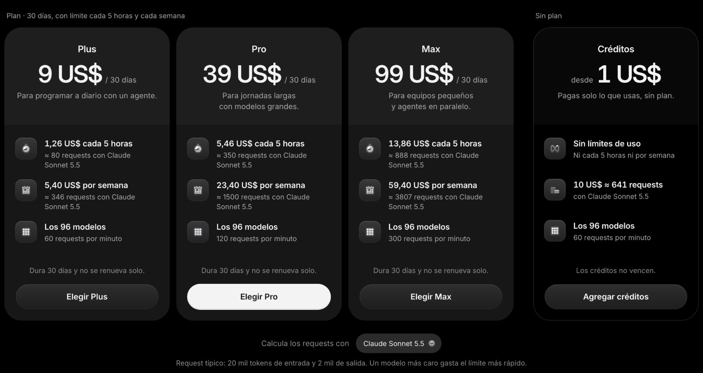
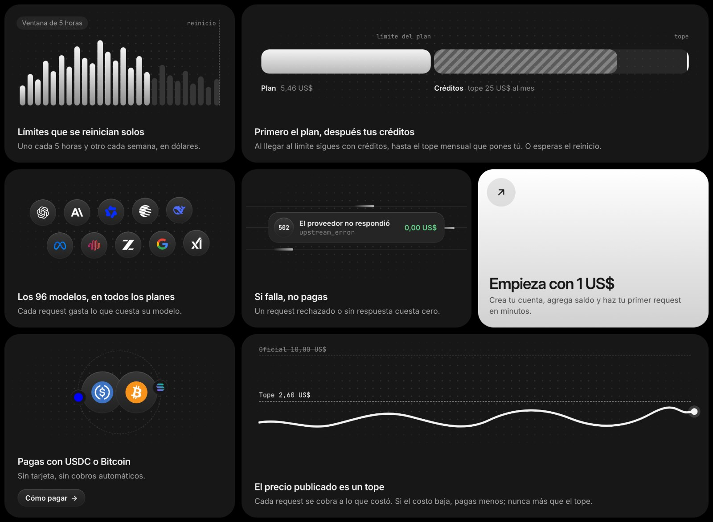
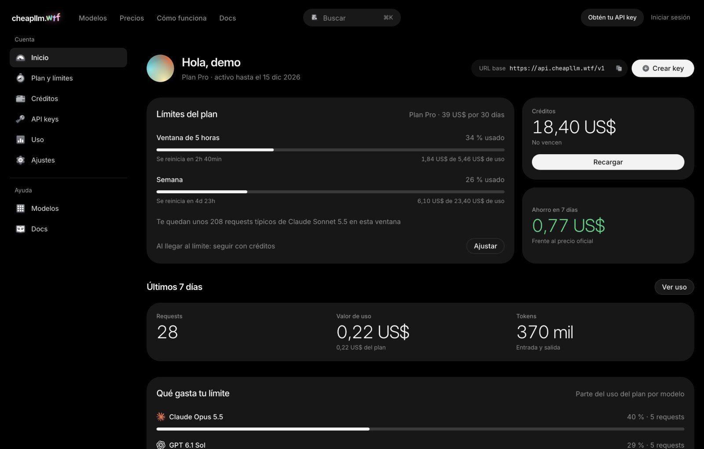

<div align="center">

# cheapllm.wtf

**Una URL para todos los modelos de IA, por menos.**

Gateway compatible con la API de OpenAI. Pides un modelo, el request va por la ruta más barata de ese momento<br>
y se cobra lo que costó, nunca más que el precio publicado.

[Sitio](https://cheapllm.wtf) · [Documentación](./docs/README.md) · [Decisiones (ADR)](./docs/adr/README.md) · [Convenciones](./AGENTS.md)

</div>

<br>


## Qué hace

- **Compatible con OpenAI.** Cambias la URL base y la key; el resto del código queda igual.
- **El precio publicado es un tope.** Cada request se cobra a lo que costó de verdad. Si el costo baja, pagas menos. Si falla, no pagas.
- **Plan, créditos o los dos.** Los planes tienen un límite cada 5 horas y otro semanal. Los créditos se cobran por uso y no vencen. La misma key sirve para todo.
- **Sin tarjeta.** Se paga con USDC (Solana o Base) o con Bitcoin.
- **Sin guardar contenido.** De cada request queda el modelo, los tokens, el costo y la hora. Nunca los mensajes ni la respuesta.

```python
from openai import OpenAI

client = OpenAI(
    base_url="https://api.cheapllm.wtf/v1",
    api_key="wtf_...",
)
```

## El producto

<table>
  <tr>
    <td width="50%" valign="top">
      
      <p><b>Precios.</b> Los planes junto a Créditos, con las requests típicas que caben según el modelo elegido.</p>
    </td>
    <td width="50%" valign="top">
      
      <p><b>Cómo se cobra.</b> Límites, el reparto entre plan y créditos, el cobro cero si falla y el precio tope.</p>
    </td>
  </tr>
  <tr>
    <td width="50%" valign="top">
      
      <p><b>Cómo funciona.</b> Los seis pasos de un request, de la key al cobro, con un recorrido que avanza con el scroll.</p>
    </td>
    <td width="50%" valign="top">
      
      <p><b>Dashboard.</b> Los límites del plan, el saldo, el ahorro y lo que gasta cada modelo.</p>
    </td>
  </tr>
</table>

## Stack

| | |
|---|---|
| **App** | Next.js 16 (App Router, Cache Components), React 19 y TypeScript estricto. El gateway (`/v1/*`) vive en la misma app ([ADR-0005](./docs/adr/0005-gateway-en-nextjs-vercel.md)). |
| **Interfaz** | Tailwind CSS v4 y shadcn/ui (`base-nova` sobre Base UI), con el estilo NibbleRouter ([ADR-0036](./docs/adr/0036-estilo-nibblerouter-completo.md)). |
| **Datos** | Postgres con Drizzle; PGlite en local ([ADR-0032](./docs/adr/0032-postgres-node-postgres-y-pglite.md)). |
| **Acceso** | Clerk en producción y un modo de desarrollo sin cuentas en local ([ADR-0050](./docs/adr/0050-login-clerk-y-modo-desarrollo.md)). |
| **Pruebas** | Vitest para unidades, componentes y el gateway; Playwright para axe y capturas. |

## Empezar en local

Sin cuentas ni Docker: la base es PGlite y el upstream es el simulado.

```bash
pnpm install
cp .env.example .env.local     # los valores de ejemplo ya funcionan en local

pnpm db:dev                    # terminal 1: Postgres local (PGlite) en 127.0.0.1:5433, datos en .pglite/
pnpm mock:upstream             # terminal 2: upstream simulado en 127.0.0.1:4010

pnpm catalog:sync              # carga catalog/ en la base (db:dev ya aplicó las migraciones)
pnpm dev                       # terminal 3: http://localhost:3000
```

Sin las claves de Clerk, `/es/sign-in` entra en modo de desarrollo: cualquier nombre o correo y cualquier código de seis dígitos (`000000` muestra el error de código incorrecto).

### Probar el gateway

```bash
pnpm keys:create -- --workspace demo            # imprime la key wtf_ una sola vez
export CHEAPLLM_API_KEY=wtf_...
pnpm credits:grant -- --workspace demo --usd 5 --note "prueba local"

curl http://localhost:3000/v1/chat/completions \
  -H "Authorization: Bearer $CHEAPLLM_API_KEY" \
  -H "Content-Type: application/json" \
  -d '{"model": "qwen/qwen3.8-flash", "messages": [{"role": "user", "content": "Hola"}]}'

pnpm reconcile                 # saldo y gasto de cada key contra los requests, y gasto por upstream
```

- **Contra InferHub de verdad:** pon `UPSTREAM_INFERHUB_API_KEY` en `.env.local`. InferHub pasa a ser el upstream de prioridad 1 y el mock queda de fallback ([ADR-0028](./docs/adr/0028-inferhub-upstream-de-pruebas.md)).
- **Escenarios del mock:** un campo `x_mock` en el body elige el escenario (`{"x_mock": {"scenario": "error-500"}}`, `cut`, `no-usage`, `hang`…). La lista está en `tests/helpers/mock-upstream.ts`.
- **Interruptor de emergencia:** poner `ops_disabled_at` en `model_upstreams` saca ese upstream en 60 s o menos, y `catalog:sync` no lo revierte ([docs/06](./docs/06-catalogo-y-precios.md#fuente-de-verdad-y-sincronización)).
- `catalog:sync` avisa que no revalidó el catálogo si `INTERNAL_REVALIDATE_SECRET` está vacío; en local es normal. Contra una base que no levantó `db:dev` (Neon), corre antes `pnpm db:migrate`.

## Scripts

| Comando | Qué hace |
|---|---|
| `pnpm dev` | Servidor de desarrollo en http://localhost:3000 |
| `pnpm build` | Build de producción |
| `pnpm lint` | ESLint |
| `pnpm typecheck` | Genera los tipos de rutas y corre `tsc` |
| `pnpm test` | Pruebas unitarias y de componentes (Vitest) |
| `pnpm test:gateway` | El gateway de punta a punta: handler real, PGlite y el upstream simulado |
| `pnpm test:e2e` | Build y pruebas en Chrome: axe y capturas por sección (Playwright). `test:e2e:update` regenera las capturas |
| `pnpm test:live` | Contra InferHub de verdad, solo con `INFERHUB_LIVE=1` y la key: gasta dinero real. Con `USDC_LIVE=1`, los adaptadores de USDC contra mainnet; solo leen y simulan |
| `pnpm check` | Lint, tipos, pruebas unitarias, pruebas del gateway y build. Se corre antes de dar algo por terminado |

## Estructura

```text
src/app/[lang]/        el sitio, el dashboard y /design-system, en español e inglés
src/app/v1/            el gateway compatible con OpenAI
src/components/        componentes de producto; ui/ son los átomos de shadcn
src/lib/               gateway, cobro, catálogo, pagos e i18n
catalog/               el catálogo de modelos y su curaduría
docs/                  producto, arquitectura, diseño y ADRs
tests/                 unit, gateway, e2e y live
```

Los componentes se agregan con `pnpm dlx shadcn@latest add <componente>`. Todos se pueden ver, en claro y en oscuro, en [`/design-system`](http://localhost:3000/design-system).

## Documentación

- [`docs/`](./docs/README.md): qué es cheapllm.wtf, cómo funciona y por qué se decidió cada cosa.
- [`docs/adr/`](./docs/adr/README.md): las decisiones de arquitectura, una por archivo.
- [`docs/13-sistema-de-diseno.md`](./docs/13-sistema-de-diseno.md): las reglas visuales.
- [`docs/18-deploy.md`](./docs/18-deploy.md): cómo se despliega.
- [`AGENTS.md`](./AGENTS.md): las convenciones del código.
