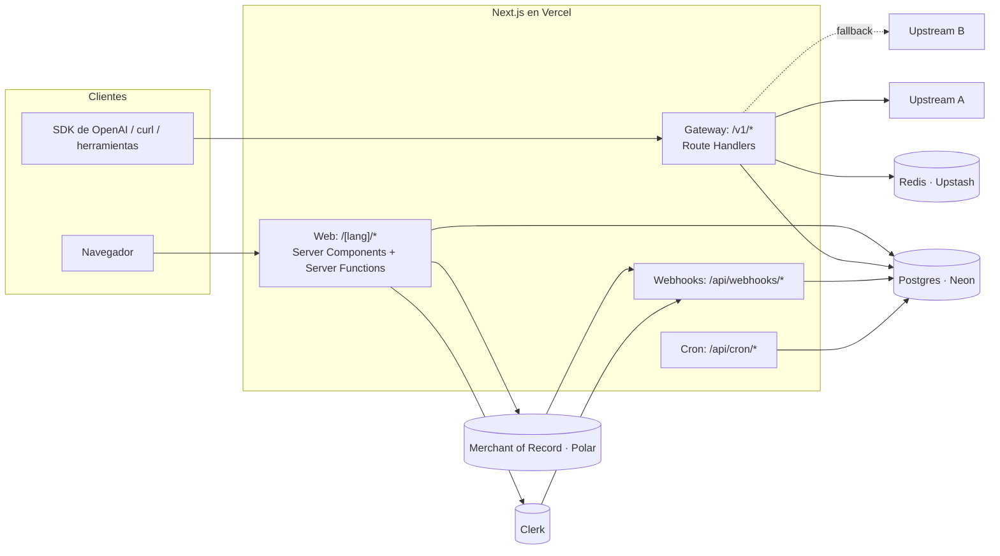
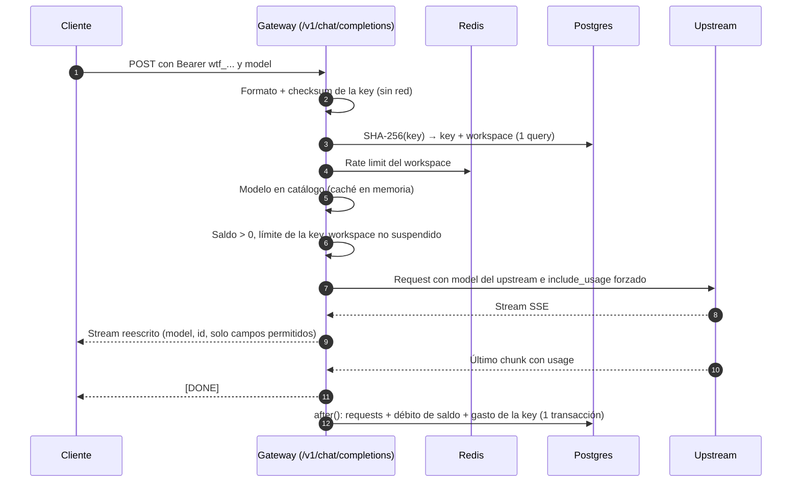

# 03 · Arquitectura

## Vista general

Una sola app de Next.js 16 en Vercel con dos caras muy distintas ([ADR-0005](./adr/0005-gateway-en-nextjs-vercel.md)):

- **Web** (landing, catálogo, docs, dashboard): está protegida con Clerk.
- **Gateway** (`/v1/*`): se autentica con nuestras API keys y no toca Clerk ([ADR-0003](./adr/0003-clerk-solo-dashboard.md)).



| Pieza | Tecnología | ADR |
|---|---|---|
| App web y gateway | Next.js 16 (App Router), runtime Node.js, Vercel con Fluid compute | [0005](./adr/0005-gateway-en-nextjs-vercel.md) |
| Base de datos | Postgres en Neon, con Drizzle ORM y node-postgres. PGlite en desarrollo y pruebas | [0032](./adr/0032-postgres-node-postgres-y-pglite.md) |
| Rate limiting | Redis en Upstash | [0017](./adr/0017-rate-limit-upstash.md) |
| Login del dashboard | Clerk | [0003](./adr/0003-clerk-solo-dashboard.md) |
| Pagos | Merchant of Record: Polar, luego Paddle (propuesta) | [0019](./adr/0019-merchant-of-record.md) |
| Dominios | Web en `cheaptokens.wtf`, API en `api.cheaptokens.wtf` | [0026](./adr/0026-marca-cheaptokens-wtf.md) |
| Inferencia | Upstreams compatibles con OpenAI. En pruebas: InferHub + upstream simulado | [0001](./adr/0001-upstreams-agregadores.md), [0028](./adr/0028-inferhub-upstream-de-pruebas.md) |

**Hosts** ([ADR-0026](./adr/0026-marca-cheaptokens-wtf.md)): la web responde en `cheaptokens.wtf` y el gateway en `api.cheaptokens.wtf`. Los dos son el mismo proyecto de Vercel. El gateway rechaza los requests que lleguen por el host web, y `proxy.ts` solo actúa en el host web.

## Estructura de carpetas (propuesta)

```
catalog/                      # Fuente de verdad del catálogo (datos, no código de app)
  models.ts                   # Modelos, precios oficiales, descuentos, tags
  upstreams.ts                # Upstreams y su mapeo/costo por modelo
scripts/
  sync-catalog.ts             # Valida y sincroniza catalog/ → Postgres (pnpm catalog:sync)
  mock-upstream.ts            # Upstream simulado para tests automáticos y fallback (ADR-0028)
src/
  proxy.ts                    # Clerk + redirección de idioma. Excluye /v1 y /api
  app/
    [lang]/                   # Toda la web, con root layout por idioma
      layout.tsx
      page.tsx                # Landing
      models/page.tsx
      docs/page.tsx
      dashboard/...
      design-system/page.tsx
    v1/
      chat/completions/route.ts
      models/route.ts
    api/
      webhooks/payments/route.ts      # Eventos del MoR, vía PaymentProvider
      webhooks/clerk/route.ts
      cron/reconcile/route.ts
      internal/revalidate-catalog/route.ts  # Lo llama catalog:sync con un secreto
  lib/
    gateway/                  # Todo el hot path. No importa Clerk, React ni next/*
      handler.ts              # handleChatCompletion(req, deps): el flujo completo (ADR-0033)
      types.ts                # Contratos: GatewayDeps, UpstreamTarget, Usage, errores
      authenticate.ts         # API key → workspace
      select-upstream.ts      # Orden de upstreams y fallback
      upstream-fetch.ts       # Request al upstream y timeouts
      sse.ts                  # Parseo y reescritura del stream
      sanitize.ts             # Whitelist de campos, ocultar upstream
      metering.ts             # Costo y transacción de cobro
      errors.ts               # Errores con formato OpenAI
    api-keys/                 # Generar, hashear, checksum
    billing/                  # Ledger e interfaz PaymentProvider (adaptador del MoR)
    catalog/                  # Consultas y cálculo de precios
    db/                       # Esquema Drizzle y cliente
    i18n/                     # Config de idiomas y diccionarios
```

**Regla:** `src/lib/gateway/` no importa nada de la web (Clerk, React, diccionarios) ni de `next/*`. El route handler le pasa todo por inyección: la base, el rate limiter, el catálogo, `fetch`, `after()`, el reloj y el logger. Así se puede mover a otro runtime sin reescribirlo ([ADR-0005](./adr/0005-gateway-en-nextjs-vercel.md), [ADR-0033](./adr/0033-gateway-con-dependencias-inyectadas.md)).

## Flujo de un request al gateway



Paso a paso:

1. **Validación local de la key.** Se revisan prefijo, longitud y checksum CRC32 sin tocar la base. La basura se rechaza con `401` sin costo ([05 · API keys](./05-api-keys.md)).
2. **Lookup.** `SHA-256(key)` se busca contra un índice único. Una sola query trae la key (revocada o no, límite y gastado) y su workspace (saldo, suspendido o no).
3. **Rate limit** por workspace en Redis. Si se excede, `429` con `retry-after`.
4. **Modelo.** Se busca en el catálogo, que vive cacheado en memoria por 60 s. Si no existe, `404 model_not_found`. Si está `retired`, `410 model_retired`.
5. **Saldo y límites,** en este orden: con el workspace suspendido, `403 account_suspended`; sin saldo, `402 insufficient_credits`; con la key en su límite, `403 key_limit_exceeded`.
6. **Upstream.** Se elige el primero habilitado según prioridad ([07 · Upstreams](./07-upstreams.md#selección-y-fallback)). Se reemplaza `model` por el ID del upstream y, si es streaming, se fuerza `stream_options.include_usage = true`. Si el upstream acepta un tope de precio (InferHub sí), se manda con el costo del mapeo ([ADR-0028](./adr/0028-inferhub-upstream-de-pruebas.md)).
7. **Fallback.** Solo si el error ocurre **antes de enviar el primer chunk de datos** (hasta entonces no salen headers): error de red, timeout, `429`, `5xx`, o `401/402/403/404` del upstream (todos son problema nuestro, no del cliente). Un `400` del upstream se devuelve al cliente sanitizado.
8. **Respuesta.** Se reescriben `id` y `model`, se dejan solo los campos del estándar de OpenAI y se descarta cualquier campo o header del upstream ([07 · Upstreams › Ocultar](./07-upstreams.md#ocultar-el-upstream)).
9. **Cobro.** Al terminar, dentro de `after()`, una sola transacción inserta el request, descuenta el saldo y suma el gasto de la key ([08 · Créditos](./08-creditos-y-pagos.md#cobro-por-request)).

## Hot path: qué toca y qué no

| Toca | No toca |
|---|---|
| Postgres: 1 lectura antes y 1 transacción después (en `after()`) | Clerk |
| Redis: 1 operación de rate limit | El MoR (pagos) |
| Memoria: catálogo cacheado 60 s | Diccionarios de i18n |
| Upstream | Cualquier render de React |

El cálculo de latencia: la key y el rate limit corren en paralelo y la base está en la misma región que las funciones. El objetivo es menos de 100 ms agregados antes del primer byte (p50).

## Streaming

- **Passthrough con transformación.** El gateway lee el SSE del upstream línea por línea y reescribe `id` y `model` en cada chunk. No acumula la respuesta: cada chunk sale apenas llega.
- **Usage.** Se fuerza `include_usage` hacia el upstream para cobrar exacto. El chunk final con `usage` se reenvía al cliente **solo si él lo pidió**. Si no lo pidió, se consume y se descarta.
- **Comentarios SSE:** **todo comentario del upstream se reemplaza por `: keep-alive`**. Nunca se reenvía tal cual, porque algunos revelan al upstream (OpenRouter manda `: OPENROUTER PROCESSING`). Antes del primer chunk de datos no se envía nada al cliente. Después, los keep-alive mantienen viva la conexión durante el razonamiento largo.
- **Errores a mitad del stream:** algunos upstreams los mandan con HTTP 200, como un chunk con `error`. El gateway los traduce a nuestro chunk de error ([04 · API › Streaming](./04-api.md#streaming)). Un stream sin contenido ni `usage` cuenta como falla.
- **Costo upstream:** si el `usage` del upstream trae `cost` (InferHub lo trae), ese es el costo que se guarda. Si no, se calcula con el costo del mapeo. En los dos casos, el campo se quita de la respuesta.
- **Si el cliente se desconecta:** el gateway **sigue leyendo el stream del upstream hasta el final**, sin escribir al cliente, para obtener `usage` y cobrar lo que el upstream nos va a cobrar. La lectura queda registrada con `after()` y respeta `maxDuration`. Ver [ADR-0013](./adr/0013-medicion-con-usage-upstream.md).
- **Duración.** El route handler exporta `maxDuration = 800` (máximo de Fluid compute en Vercel Pro). Un stream que dure más se corta, se registra como `upstream_timeout` y se cobra lo estimado.

## Timeouts

| Timeout | Valor inicial | Qué pasa al vencer |
|---|---|---|
| Conexión al upstream | 10 s | Fallback al siguiente upstream |
| Primer byte (modelos normales) | 60 s | Fallback |
| Primer byte (modelos con tag `reasoning`) | 180 s | Fallback |
| Duración total | 800 s (`maxDuration`) | Se corta, se cobra lo estimado |

Son valores iniciales configurables. Se revisan con datos reales.

## Web (dashboard)

- Server Components para leer y Server Functions para mutar (crear o revocar key, iniciar checkout).
- **`proxy.ts` no es la autorización.** La documentación de Next 16 lo dice explícitamente: el proxy sirve para redirecciones optimistas. Cada página privada y cada Server Function vuelve a verificar la sesión con `auth()` de Clerk y resuelve el workspace del usuario antes de tocar datos.
- El workspace se crea **de forma perezosa**: la primera vez que un usuario autenticado entra al dashboard se hace un upsert por `clerk_user_id` ([ADR-0016](./adr/0016-workspace-dueno.md)).
- `cacheComponents` está activo en `next.config.ts`. El dashboard lee datos por usuario en tiempo de request. El catálogo público y `GET /v1/models` se cachean con `use cache` y `cacheTag('catalog')`. Al terminar, `pnpm catalog:sync` llama a `/api/internal/revalidate-catalog` (protegido con un secreto), que ejecuta `revalidateTag('catalog', 'max')`.

## Webhooks

| Origen | Evento | Acción |
|---|---|---|
| MoR | Pago completado (`TopupPaid`) | Crea la recarga de forma idempotente (por el ID del pago) y suma saldo |
| MoR | Disputa (`Disputed`) | Suspende el workspace y alerta |
| MoR | Reembolso (`Refunded`) | Ajuste negativo de saldo |
| Clerk | `user.deleted` | Revoca todas las keys y marca el workspace como borrado |

Todos los webhooks verifican la firma y son idempotentes.

## Cron (Vercel Cron)

- **Diario:** reconciliación de saldos. Compara `workspaces.balance` contra Σ recargas − Σ requests y alerta si hay diferencia ([09 · Modelo de datos](./09-modelo-de-datos.md#invariantes)).
- **Fase 2:** health checks y saldo de cada upstream.

## Seguridad

- **Secretos solo en variables de entorno:** `DATABASE_URL`, llaves de Clerk, llave y secreto de webhook del MoR, credenciales de Upstash y `UPSTREAM_<ID>_API_KEY` por upstream. Las llaves de los upstreams nunca van en la base ni en el repo.
- **Logs:** nunca incluyen el header `Authorization`, el body del request ni el de la respuesta. Solo `request_id`, workspace, key, modelo, upstream, estado, tokens y latencias.
- **Errores del upstream:** se sanitizan. El mensaje se reemplaza por uno nuestro sin nombres ni URLs del upstream.
- **API keys:** se guarda solo el hash ([05 · API keys](./05-api-keys.md)).
- **Sin CORS en la API:** una API key en el navegador es una key filtrada ([ADR-0026](./adr/0026-marca-cheaptokens-wtf.md)).
- **Dashboard:** se verifica la sesión en cada Server Function. Ninguna acción confía en IDs que vengan del cliente sin comprobar que pertenecen al workspace del usuario.

## Límites conocidos de la plataforma

| Límite | Valor | Consecuencia |
|---|---|---|
| Duración máxima de una función (Fluid compute) | 300 s en Hobby, 800 s en Pro | Producción en **Pro**. Hobby además es solo para uso personal no comercial |
| Tamaño del body del request en Vercel Functions | 4.5 MB | Las imágenes grandes en base64 fallan. Se documenta en `/docs` y se devuelve `413` |
| Fluid compute cobra por duración y memoria | — | Los streams largos cuestan. Se monitorea el costo por request |

**Cuándo sacar el gateway a Cloudflare Workers:** cuando haya requests legítimos de más de 800 s, cuando el límite de 4.5 MB bloquee a usuarios reales, o cuando el costo de cómputo por request en Vercel supere un umbral relevante frente al margen. El aislamiento de `src/lib/gateway/` es lo que hace barata esa migración.

## Observabilidad (MVP)

- Logs estructurados en JSON con `request_id` en cada línea. El `request_id` se devuelve en el header `x-request-id` para soporte.
- Tablero simple sobre la tabla `requests`: tasa de error por upstream, latencia p50/p95 al primer byte y margen diario.
- **Fase 2:** alertas automáticas por tasa de error de un upstream, saldo bajo con un upstream y diferencias de reconciliación.
