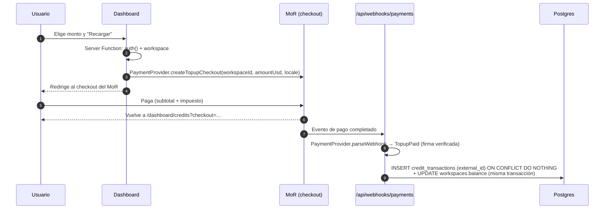

# 08 · Créditos y pagos

## Modelo

- **Prepago en USD** ([ADR-0008](./adr/0008-creditos-prepagados.md)). El usuario recarga créditos y cada request los descuenta.
- **Todo el dinero se guarda como enteros en µUSD** (1 USD = 1,000,000 µUSD) ([ADR-0007](./adr/0007-dinero-en-micro-dolares.md)). Nunca se usan floats para dinero.
- **No hay créditos gratis** al registrarse ([ADR-0018](./adr/0018-sin-creditos-gratis.md)).
- **No hay suscripción ni pospago.**
- **Los créditos son saldo prepagado del servicio cheaptokens.wtf:** no se transfieren, no se retiran, no tienen valor fuera del servicio y no se reembolsan salvo error ([ADR-0019](./adr/0019-merchant-of-record.md), [ADR-0020](./adr/0020-intermediario-entidad-mexico.md)).

## Quién cobra: un Merchant of Record

([ADR-0019](./adr/0019-merchant-of-record.md), en estado *Propuesta* hasta tener la aprobación por escrito)

- El **MoR** es el vendedor legal frente al cliente: cobra, calcula y paga los impuestos de cada país, emite la factura al cliente y atiende los contracargos. Nos transfiere lo neto a la empresa en México.
- **Primera opción: Polar** (4% + 40¢ por transacción, paga a México vía Stripe Connect Express). **Segunda: Paddle** (alrededor de 5% + 50¢).
- **Requisito previo:** las políticas de uso de los dos tienen cláusulas que podrían excluir el negocio (reventa de servicios de terceros y "stored value"). **No se escribe código de pagos hasta que uno lo apruebe por escrito**, con la descripción exacta del negocio.
- **Plan B:** Stripe directo con Stripe Tax ([ADR-0009](./adr/0009-stripe-checkout.md)).
- El código no sabe qué MoR se usa: todo pasa por la interfaz `PaymentProvider` de `src/lib/billing/`.

## Recargas

- **Montos:** atajos de $10, $25, $50 y $100, más un monto libre entre **$10 y $1,000**, en dólares enteros.
  - **Mínimo $10.** La comisión del MoR en una recarga de $10 es de unos $0.80 a $1.00 (8–10%). Subir el mínimo está en las [preguntas abiertas](./12-preguntas-abiertas.md).
  - **Máximo $1,000:** limita el daño de una tarjeta robada.
- **Impuestos:** el monto elegido es el **subtotal sin impuestos**. El MoR agrega el impuesto que corresponda al país del comprador en el checkout. Acreditamos exactamente el subtotal: si elige $10, recibe $10 en créditos.
- **Métodos de pago:** los que ofrezca el checkout del MoR (tarjeta y wallets como mínimo).

### Flujo



- **Idempotencia:** `credit_transactions.external_id` es único. Si el MoR reenvía el evento, el insert no hace nada y el saldo no se suma dos veces.
- **La página de retorno no suma saldo.** Solo muestra el estado. El saldo lo suma únicamente el webhook. Si el webhook todavía no llegó, la página dice "Procesando…" y se refresca.
- **Recibos y facturas:** los emite el MoR. El historial del dashboard enlaza al recibo.

## Saldo

- `workspaces.balance_micro_usd` es un valor **desnormalizado**. Se actualiza en la misma transacción que cada movimiento.
- **La verdad está en dos tablas:** `credit_transactions` (entradas: recargas, ajustes, reembolsos) y `requests` (salidas: uso).
- **Invariante:** `balance = Σ credit_transactions.amount − Σ requests.cost`. Un cron diario lo verifica y alerta si no cuadra ([09 · Modelo de datos](./09-modelo-de-datos.md#invariantes)).

## Cobro por request

**Antes del request** (en el hot path, sin escrituras):

- Si `balance ≤ 0`: `402 insufficient_credits`.
- Si la key tiene límite y `spent ≥ limit`: `403 key_limit_exceeded`.
- Si el workspace está suspendido: `403 account_suspended`.

**Después del request** (en `after()`, una sola transacción):

```sql
BEGIN;
INSERT INTO requests (id, workspace_id, api_key_id, model_id, upstream_id, ...,
                      prompt_tokens, completion_tokens,
                      cost_micro_usd, upstream_cost_micro_usd, official_cost_micro_usd)
VALUES (...);

UPDATE workspaces
SET balance_micro_usd = balance_micro_usd - $cost
WHERE id = $workspace_id;

UPDATE api_keys
SET spent_micro_usd = spent_micro_usd + $cost, last_used_at = now()
WHERE id = $api_key_id;
COMMIT;
```

### El saldo puede quedar levemente negativo

No hacemos reserva previa: no sabemos cuánto va a costar un request hasta que termina. Con `balance > 0` como única condición, varios requests en paralelo pueden pasar el chequeo a la vez y dejar el saldo por debajo de cero.

- **Exposición máxima ≈ requests en vuelo × costo máximo de un request.** El rate limit (60 req/min por workspace) acota cuántos requests hay en vuelo, y con precios de centavos por request la exposición es pequeña.
- Con saldo negativo, todo request siguiente recibe `402`. La siguiente recarga cubre primero la deuda.
- Se descartó la reserva previa (retener `max_tokens × precio` antes del request) para el MVP, por complejidad. Ver [ADR-0008](./adr/0008-creditos-prepagados.md).

### Requests que fallan

| Caso | ¿Se cobra? |
|---|---|
| Rechazado antes del upstream (401, 402, 403, 404, 429) | No. Tampoco se registra en `requests` |
| Todos los upstreams fallaron (502, 503, 504) | No. Se registra con costo 0 |
| `400` del upstream (request inválido) | No, salvo que el upstream reporte `usage` |
| El stream se cortó a la mitad por el upstream | Se cobra el `usage` reportado. Si no llegó, se estima ([ADR-0013](./adr/0013-medicion-con-usage-upstream.md)) |
| El cliente se desconectó | Se cobra todo lo que el upstream generó, porque a nosotros nos lo cobra |

## Fraude, reembolsos y contracargos

Es el riesgo más concreto del prepago de IA: alguien recarga con una tarjeta robada, quema los créditos (que a nosotros sí nos cuestan en el upstream) y luego llega el contracargo. El MoR atiende la disputa con el banco, pero **el costo del upstream ya lo pagamos nosotros**.

- **Antifraude del MoR,** con su configuración por defecto.
- **Máximo $1,000 por recarga** y, en el MVP, como máximo 3 recargas por workspace en 24 h.
- **Evento `Disputed`:** suspende el workspace al instante (`suspended_at`) y dispara una alerta. Las keys dejan de funcionar con `403 account_suspended`.
- **Evento `Refunded`:** registra un ajuste negativo por el monto reembolsado.

## Contabilidad y fiscal en México

Lo tiene que validar un contador ([preguntas abiertas](./12-preguntas-abiertas.md)):

- **Ingresos:** el MoR nos paga en USD. Probablemente se factura (CFDI) al MoR como exportación de servicios.
- **Compras a upstreams extranjeros:** pagar servicios del extranjero tiene implicaciones de IVA para una empresa mexicana.
- **Clientes mexicanos que necesiten CFDI:** dependen de lo que pueda emitir el MoR.
