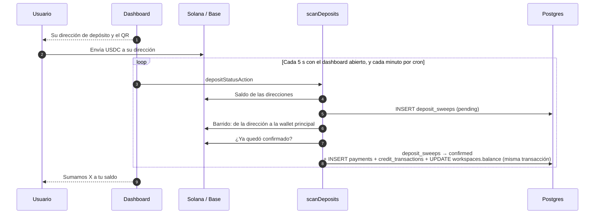

# 08 · Créditos y pagos

## Modelo

Hay dos formas de pagar el uso, y un request las usa en este orden ([ADR-0049](./adr/0049-suscripcion-con-limites.md), [ADR-0058](./adr/0058-deposito-por-cuenta-y-saldo.md)):

1. **Plan** con un límite cada 5 horas y otro cada semana. Se paga por 30 días.
2. **Créditos:** saldo prepagado en USD, para cualquier modelo. Cada request los descuenta.

- **Lo que entra de fuera son depósitos en USDC y pagos en Bitcoin** ([ADR-0065](./adr/0065-pagos-en-bitcoin.md)). Los dos se vuelven saldo; el plan se compra con ese saldo.
- **Todo el dinero se guarda como enteros en µUSD** (1 USD = 1,000,000 µUSD) ([ADR-0007](./adr/0007-dinero-en-micro-dolares.md)). Nunca se usan floats para dinero.
- **No hay créditos gratis** al registrarse ([ADR-0018](./adr/0018-sin-creditos-gratis.md)).
- **No hay pospago.**
- **Los créditos son saldo prepagado del servicio cheapllm.wtf:** no se transfieren, no se retiran, no tienen valor fuera del servicio y no se reembolsan salvo error ([ADR-0019](./adr/0019-merchant-of-record.md), [ADR-0020](./adr/0020-intermediario-entidad-mexico.md)).
- **Los paquetes por modelo ya no se venden** ([ADR-0058](./adr/0058-deposito-por-cuenta-y-saldo.md)). El cobro todavía sabe gastar uno que exista, entre el plan y los créditos.

<a id="recargas"></a>

## Depósitos en USDC

([ADR-0058](./adr/0058-deposito-por-cuenta-y-saldo.md). El Merchant of Record de [ADR-0019](./adr/0019-merchant-of-record.md) y Stripe quedan en pausa.)

- **Cada cuenta tiene su propia dirección de depósito** en Solana y en Base. Es fija: se puede guardar y reusar.
- **Cualquier monto desde 1 USDC.** Lo que llega se acredita completo; no hay montos exactos ni órdenes que vencen.
- **El sistema barre lo recibido a la wallet principal** de cada red (`CRYPTO_SOLANA_ADDRESS`, `CRYPTO_BASE_ADDRESS`) **y acredita cuando ese barrido queda confirmado.** Lo acreditado es siempre lo que llegó a la wallet principal.
- **Las llaves de las direcciones de depósito salen de `CRYPTO_DEPOSIT_SEED`.** Es el único secreto de pagos. La llave de la wallet principal nunca pasa por el servidor.
- **La comisión de red de cada barrido la paga otra wallet,** también derivada de la semilla: el fee payer en Solana y el relayer en Base. Hay que mantenerlas con SOL y con ETH; cada barrido cuesta fracciones de centavo.
- **Cuándo se revisa:** con el dashboard abierto, cada 5 segundos. Además un cron de Vercel corre cada minuto (`/api/internal/crypto-payments`) y revisa las direcciones abiertas en las últimas 24 horas y un turno de 300 de las demás.
- **Cuándo se acredita:** en Solana, con el barrido finalizado; en Base, con 10 bloques encima. En total, alrededor de medio minuto después del depósito.
- **Sin comisión de intermediario ni contracargos.** Los impuestos y la contabilidad son nuestros: no hay MoR que los calcule.
- **Otro token u otra red no se acreditan solos.** Se recuperan a mano con la llave de esa dirección.
- El código vive en `src/lib/payments/crypto/`. Lo que pasa después de un depósito acreditado sigue en `src/lib/billing/purchases.ts`.

### Operación

- `pnpm payments:status --new-seed` genera la semilla. Se guarda en un gestor de contraseñas y en Vercel. **No se cambia nunca:** lo que llegue a las direcciones actuales quedaría sin llave.
- `pnpm payments:status` muestra las redes activas, la wallet principal, las wallets de comisiones con su saldo y los barridos sin resolver. Con `--scan` corre un barrido en el momento.
- **La wallet principal de Solana tiene que haber recibido USDC antes:** el barrido solo envía a una cuenta de USDC que ya existe. La de Base se configura con mayúsculas y minúsculas, como la muestra la wallet.
- **Alertas en los logs** (`severity: critical`): `deposit_fee_wallet_low`, `deposit_sweep_not_prepared`, `deposit_sweep_not_sent` y `deposit_address_mismatch`.

### Desarrollo local

- **Sin semilla ni wallets y con `APP_ENV=development`,** el dashboard muestra direcciones de ejemplo y un botón «Simular un depósito», que acredita sin cadena (red `dev`).
- **En preview y producción sin configuración,** el dashboard muestra los depósitos como no disponibles. Con saldo se puede seguir comprando un plan.
- **Para probar contra una cadena:** `CRYPTO_SOLANA_CLUSTER=devnet` o `CRYPTO_BASE_CHAIN=sepolia`, con USDC de prueba.
- `USDC_LIVE=1 pnpm test:live` comprueba los adaptadores contra mainnet solo con lecturas y simulaciones: no envía nada ni necesita fondos.
- Fuera de Vercel, sin `APP_ENV` ni `VERCEL_ENV`, la app se considera de desarrollo. Un servidor propio debe poner `APP_ENV=production`.

<a id="bitcoin"></a>

## Pagos en Bitcoin

([ADR-0065](./adr/0065-pagos-en-bitcoin.md). Solo on-chain; Lightning queda para una segunda fase.)

- **El servidor solo tiene la xpub de una cuenta BIP84** (`CRYPTO_BITCOIN_XPUB`). Las direcciones salen de ahí y lo que llega ya está en la wallet del dueño: no hay barrido, ni wallet de comisiones, ni llaves en el servidor.
- **Cada workspace tiene una dirección vigente, y cambia cuando recibe un pago.** Las anteriores siguen funcionando y se acreditan al mismo workspace.
- **Cada compra abre una cotización:** cuánto en USD, cuántos sats, a qué precio y para qué. **El precio queda fijo 15 minutos.** Créditos desde $10 hasta $10,000; para un plan, lo que falta después del saldo.
- **El precio es la mediana de Coinbase, Kraken y Bitstamp,** sin margen. Si no hay dos fuentes que coincidan dentro de 1 %, no se cotiza.
- **Lo que se ve en la red a tiempo** (hasta 2 minutos después del vencimiento, y sin pasar de lo cotizado + 10 %) **usa el precio cotizado. Lo que llega después, el del momento en que se ve.**
- **Se acredita con 1 confirmación** (`CRYPTO_BITCOIN_CONFIRMATIONS`), nunca con 0: con full-RBF un pago sin confirmar se puede redirigir. Unos 10 minutos, a veces hasta una hora.
- **Un plan se compra solo al confirmarse, aunque se haya cerrado el diálogo.** Si al saldo le falta hasta 2 % del precio, el plan entra igual y la diferencia queda como ajuste (`credit_transactions`, `external_id = bitcoin-tolerance:<cotización>`). Si falta más, lo recibido queda como saldo y otro pago a la misma cotización vuelve a intentarlo. Si el plan vigente cambió desde la cotización, el pago queda como saldo.
- **Cuándo se revisa:** con el diálogo abierto, cada 10 segundos (cada 30 después de 10 minutos). El cron de cada minuto lee las direcciones con cotización o pago en las últimas 24 horas y un turno de 20 de las demás. Se lee con mempool.space (`CRYPTO_BITCOIN_ESPLORA_URL`).
- **Un pago que desaparece sin confirmarse** (reemplazado o expulsado del mempool) deja de mostrarse a los 30 minutos.
- El código vive en `src/lib/payments/bitcoin/`.

### Operación

- **La xpub tiene que ser de una cuenta dedicada a cheapllm.wtf,** exportada como `zpub` o `xpub` desde Sparrow o la hardware wallet. Una llave privada, de otra red o que no es de una cuenta se rechaza al arrancar.
- **Antes de cobrar,** `pnpm payments:status` muestra la primera dirección que da la xpub: tiene que coincidir con la primera de recibir de la wallet.
- **Gap limit:** la wallet solo ve direcciones hasta cierto hueco sin uso. `pnpm payments:status` dice cuántas direcciones sin usar hay; en Sparrow el gap limit se sube en Settings › Advanced. Si no se sube, los pagos no se pierden: aparecen al subirlo.
- **Lo cobrado en BTC se queda en BTC** hasta convertirlo a mano. A InferHub se le paga en USDC.
- **Alertas en los logs:** `bitcoin_address_mismatch` (`severity: critical`), `bitcoin_scan_failed` y `bitcoin_address_scan_failed`.

### Desarrollo local

- **Sin xpub y con `APP_ENV=development`,** la dirección sale de la xpub pública de ejemplo de BIP84 en signet, el precio es fijo ($90,000) y el diálogo trae «Simular el pago» y «Simular la confirmación».
- **Para probar contra una cadena:** `CRYPTO_BITCOIN_NETWORK=testnet4` o `signet`, con la `tpub` o `vpub` de una wallet de prueba.

## Planes

| Plan | Precio por 30 días | Ventana de 5 horas | Semana | Requests por minuto |
|---|---|---|---|---|
| Plus | $9 | $1.26 | $5.40 | 60 |
| Pro | $39 | $5.46 | $23.40 | 120 |
| Max | $99 | $13.86 | $59.40 | 300 |

- **Precios de [ADR-0052](./adr/0052-precios-de-los-planes.md).** La ventana es el 14 % del precio y la semana el 60 %.
- **Los límites se miden en valor de uso a precio cheapllm.wtf:** cada request gasta del límite lo mismo que costaría en créditos. Están en `src/lib/billing/plans.ts`. **Son valores iniciales que hay que calibrar** antes de lanzar ([ADR-0049 › Margen](./adr/0049-suscripcion-con-limites.md#margen)).
- **Ventanas:** empiezan con el primer request que cobra del plan y se reinician a las 5 horas y a los 7 días (`usage_windows`). Lo que queda del plan es el menor de los dos restos.
- **El plan vale** mientras la suscripción esté `active` y no haya pasado `current_period_end`, aunque se haya pedido cancelar al final del periodo.
- **Subir de plan** aplica ya y cobra la diferencia prorrateada por lo que queda del periodo. Lo usado cuenta sobre el límite nuevo.
- **Se paga con saldo, 30 días a la vez,** y no se renueva solo ([ADR-0058](./adr/0058-deposito-por-cuenta-y-saldo.md)). Pagar el plan vigente suma 30 días al final del periodo actual.
- **Si el saldo no alcanza,** el diálogo de compra muestra el depósito y completa la compra cuando llega, mientras siga abierto. **Con Bitcoin la completa el servidor al confirmarse**, aunque el diálogo se cierre.
- **Bajar de plan:** el plan más barato se compra cuando termina el vigente. No hay cancelación: el plan vence solo.

## Orden de cobro y excedente

- **Plan → créditos.** Las keys de solo créditos (`prepaid_only`) se saltan el plan; las de solo plan (`plan_only`) nunca tocan los créditos ([05 · API keys](./05-api-keys.md#fuente-de-cobro-y-modelos)).
- **El request que cruza el límite termina completo.** Lo que no cabe en el plan va al excedente.
- **El excedente se configura por workspace** en Plan y límites:
  - **Modo:** `continue` (seguir con créditos, el default) o `stop` (`429 usage_limit_reached` hasta el reinicio).
  - **Interruptor:** usar créditos.
  - **Tope mensual de créditos** usados como excedente, por mes UTC. Default: $25.
- **Lo que nadie paga lo absorbemos** (`requests.absorbed_micro_usd`): pasa cuando el excedente está apagado o llegó al tope. El siguiente request recibe `429 usage_limit_reached` con `retry-after`.
- Sin plan, o con una key de solo créditos, los créditos pagan sin tope de excedente.
- **Un paquete por modelo que todavía exista** se gasta después del plan y antes de los créditos, solo en requests de su modelo.

## Flujo de un depósito



- **Idempotencia:** el barrido se guarda antes de enviarse y pasa a `confirmed` una sola vez; el pago lleva `external_id = <red>:<transacción>`. Revisar dos veces el mismo barrido no acredita dos veces.
- **Un solo barrido en vuelo por dirección.** Si dos procesos ven el mismo saldo, solo uno lo guarda; y la cadena solo deja moverlo una vez.
- **Recibos:** el historial del dashboard enlaza a la transacción del barrido en Solscan o Basescan.

## Saldo

- `workspaces.balance_micro_usd` es un valor **desnormalizado**. Se actualiza en la misma transacción que cada movimiento.
- **La verdad está en dos tablas:** `credit_transactions` (depósitos, ajustes y reembolsos; y en negativo, los planes comprados con saldo) y `requests` (la parte de cada request que pagaron los créditos).
- **Invariante:** `balance = Σ credit_transactions.amount − Σ requests.credits_micro_usd`. La conciliación (`src/lib/billing/reconcile.ts`) lo verifica y alerta si no cuadra ([09 · Modelo de datos](./09-modelo-de-datos.md#invariantes)).

## Cobro por request

**Antes del request** (en el hot path, sin escrituras). El plan y sus ventanas llegan en la misma query que la key. En este orden (la suspensión va primero: un workspace suspendido no debe enterarse de su saldo):

- Si el workspace está suspendido: `403 account_suspended`.
- Si la key no permite el modelo: `403 model_not_allowed_for_key`.
- Si la key tiene límite y `spent ≥ limit`: `403 key_limit_exceeded`.
- **Admisión** (`admit` en `src/lib/billing/limits.ts`). Pasa si al plan le queda límite. Si no, pasa si hay paquete del modelo o créditos permitidos (saldo > 0 y, en el excedente, tope disponible). El saldo de paquetes es una query más y solo se hace cuando el plan no alcanza. Si no pasa:
  - con plan, y la key no es de solo créditos: `429 usage_limit_reached`, con `retry-after` hasta el reinicio;
  - key de solo plan sin plan activo: `402 no_active_plan`;
  - en cualquier otro caso: `402 insufficient_credits`.

**Cuánto se cobra** ([ADR-0054](./adr/0054-cobro-por-costo-real.md)): el costo real que reporta el upstream × 1.3, hacia arriba. El precio del catálogo es una referencia y el máximo por token; solo se cobra con él cuando el upstream no reporta su costo.

**Después del request** (en `after()`, una sola transacción, `chargeRequest` en `src/lib/billing/ledger.ts`):

```sql
BEGIN;
SELECT ... FROM workspaces WHERE id = $workspace_id FOR UPDATE;   -- serializa los cobros del workspace
-- splitCharge reparte $cost: plan → paquete → créditos → absorbido
INSERT INTO usage_windows ... ON CONFLICT DO UPDATE;              -- ventana de 5 h y semana, si pagó el plan
UPDATE model_packs SET balance_micro_usd = balance_micro_usd - $pack WHERE id = $pack_id;
UPDATE workspaces SET balance_micro_usd = balance_micro_usd - $credits,
                      overflow_spent_micro_usd = ...               -- solo si fue excedente
WHERE id = $workspace_id;
INSERT INTO requests (..., cost_micro_usd, plan_micro_usd, pack_micro_usd,
                      credits_micro_usd, absorbed_micro_usd, pack_id, ...)
VALUES (...);
UPDATE api_keys
SET spent_micro_usd = spent_micro_usd + $cost, last_used_at = now()
WHERE id = $api_key_id;
COMMIT;
```

### El saldo puede quedar levemente negativo

No hacemos reserva previa: no sabemos cuánto va a costar un request hasta que termina. Con `balance > 0` como única condición, varios requests en paralelo pueden pasar el chequeo a la vez y dejar el saldo por debajo de cero.

- **Exposición máxima ≈ requests en vuelo × costo máximo de un request.** El rate limit (60 req/min por workspace, o el del plan) acota cuántos requests hay en vuelo, y con precios de centavos por request la exposición es pequeña. Lo mismo acota lo que absorbemos cuando un request cruza el límite del plan.
- Con saldo negativo, todo request siguiente recibe `402`. La siguiente recarga cubre primero la deuda.
- Se descartó la reserva previa (retener `max_tokens × precio` antes del request) para el MVP, por complejidad. Ver [ADR-0008](./adr/0008-creditos-prepagados.md) y [ADR-0049](./adr/0049-suscripcion-con-limites.md).

### Requests que fallan

| Caso | ¿Se cobra? |
|---|---|
| Rechazado antes del upstream (401, 402, 403, 404, 429) | No. Tampoco se registra en `requests` |
| Todos los upstreams fallaron (502, 503, 504) | No. Se registra con costo 0 |
| `400` del upstream (request inválido) | No, salvo que el upstream reporte `usage` |
| El stream se cortó a la mitad por el upstream | Se cobra el `usage` reportado. Si no llegó, se estima ([ADR-0013](./adr/0013-medicion-con-usage-upstream.md)) |
| El cliente se desconectó | Se cobra todo lo que el upstream generó, porque a nosotros nos lo cobra |

## Fraude, reembolsos y contracargos

- **Un depósito en USDC o un pago en Bitcoin no tienen contracargo:** desaparece el riesgo de la tarjeta robada que quema créditos.
- **Reembolsos:** a mano, enviando USDC desde la wallet principal, y con un ajuste negativo en `credit_transactions`.
- **Suspender un workspace** (`suspended_at`) sigue disponible para abusos: las keys responden `403 account_suspended`.
- **Si se filtra la semilla,** quien la tenga puede mover los depósitos que todavía no se barrieron (lo de uno o dos minutos). Lo ya barrido está en la wallet principal, fuera de su alcance.
- **Cuando se sume Stripe o un MoR** vuelven el antifraude, el tope de recargas por día y los eventos `Disputed` y `Refunded`.

## Contabilidad y fiscal en México

Lo tiene que validar un contador ([preguntas abiertas](./12-preguntas-abiertas.md)):

- **Ingresos en USDC y en Bitcoin:** cómo se registran, a qué tipo de cambio y cuándo se reconoce el ingreso. Cada pago queda con su transacción en `payments.receipt_url`; los de Bitcoin, además, con el precio aplicado y su fuente en `bitcoin_receipts`.
- **IVA de cada cliente:** sin MoR, nadie lo calcula ni lo cobra por nosotros.
- **Compras a upstreams extranjeros:** pagar servicios del extranjero (InferHub, en USDC) tiene implicaciones de IVA para una empresa mexicana.
- **Clientes mexicanos que necesiten CFDI:** los tendríamos que emitir nosotros.
