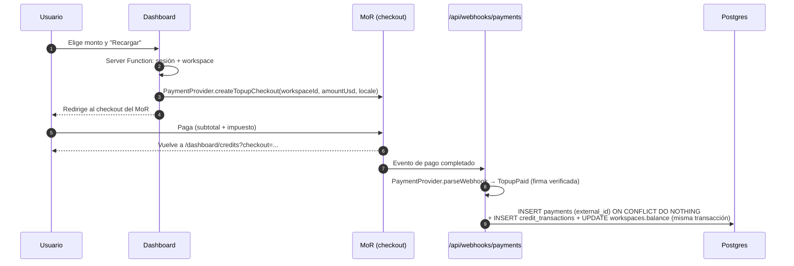

# 08 · Créditos y pagos

## Modelo

Hay tres formas de pagar el uso, y un request las usa en este orden ([ADR-0049](./adr/0049-suscripcion-con-limites.md)):

1. **Plan mensual** con un límite cada 5 horas y otro cada semana.
2. **Paquete del modelo:** uso prepagado de un solo modelo, con 20 % extra.
3. **Créditos:** saldo prepagado en USD. Cada request los descuenta.

- **Todo el dinero se guarda como enteros en µUSD** (1 USD = 1,000,000 µUSD) ([ADR-0007](./adr/0007-dinero-en-micro-dolares.md)). Nunca se usan floats para dinero.
- **No hay créditos gratis** al registrarse ([ADR-0018](./adr/0018-sin-creditos-gratis.md)).
- **No hay pospago.**
- **Los créditos son saldo prepagado del servicio cheaptokens.wtf:** no se transfieren, no se retiran, no tienen valor fuera del servicio y no se reembolsan salvo error ([ADR-0019](./adr/0019-merchant-of-record.md), [ADR-0020](./adr/0020-intermediario-entidad-mexico.md)).

## Quién cobra: un Merchant of Record

([ADR-0019](./adr/0019-merchant-of-record.md), en estado *Propuesta* hasta tener la aprobación por escrito)

- El **MoR** es el vendedor legal frente al cliente: cobra, calcula y paga los impuestos de cada país, emite la factura al cliente y atiende los contracargos. Nos transfiere lo neto a la empresa en México.
- **Primera opción: Polar** (4% + 40¢ por transacción, paga a México vía Stripe Connect Express). **Segunda: Paddle** (alrededor de 5% + 50¢).
- **Requisito previo:** las políticas de uso de los dos tienen cláusulas que podrían excluir el negocio (reventa de servicios de terceros y "stored value"). **No se integra ningún MoR hasta que uno lo apruebe por escrito**, con la descripción exacta del negocio.
- **Plan B:** Stripe directo con Stripe Tax ([ADR-0009](./adr/0009-stripe-checkout.md)).
- El código no sabe qué MoR se usa: todo pasa por la interfaz `PaymentProvider` de `src/lib/payments/index.ts`. Lo que pasa después de un cobro confirmado está en `src/lib/billing/purchases.ts`.
- La descripción para el MoR tiene que incluir los planes mensuales y los paquetes, no solo las recargas.

### Proveedor de desarrollo

Mientras ningún MoR apruebe, solo existe un proveedor de desarrollo:

- **Solo con `APP_ENV=development`.** En preview y producción `getPaymentProvider()` devuelve null y el dashboard muestra los pagos como no disponibles.
- **Confirma al instante y no cobra nada.** Devuelve un pago `dev_<uuid>` y la server action lo aplica en el momento (recarga, plan o paquete).
- Fuera de Vercel, sin `APP_ENV` ni `VERCEL_ENV`, la app se considera de desarrollo. Un servidor propio debe poner `APP_ENV=production`.

## Planes

| Plan | Precio al mes | Ventana de 5 horas | Semana | Requests por minuto |
|---|---|---|---|---|
| Plus | $20 | $2.50 | $12 | 60 |
| Pro | $50 | $7 | $30 | 120 |
| Max | $150 | $22 | $90 | 300 |

- **Los límites se miden en valor de uso a precio cheaptokens.wtf:** cada request gasta del límite lo mismo que costaría en créditos. Están en `src/lib/billing/plans.ts`. **Son valores iniciales que hay que calibrar** antes de lanzar ([ADR-0049 › Margen](./adr/0049-suscripcion-con-limites.md#margen)).
- **Ventanas:** empiezan con el primer request que cobra del plan y se reinician a las 5 horas y a los 7 días (`usage_windows`). Lo que queda del plan es el menor de los dos restos.
- **El plan vale** mientras la suscripción esté `active` y no haya pasado `current_period_end`, aunque se haya pedido cancelar al final del periodo.
- **Subir de plan** aplica ya y cobra la diferencia prorrateada por lo que queda del periodo. Lo usado cuenta sobre el límite nuevo.
- **Bajar de plan** se programa para la renovación (`next_plan_id`). **Cancelar** marca `cancel_at_period_end`: el plan termina con el periodo y después se paga con créditos.
- **Todavía no hay renovación:** llegará con el webhook del MoR. Con el proveedor de desarrollo el periodo dura 30 días y vence.

## Paquetes por modelo

- Pagas X y recibes X × 1.2 de uso de un modelo (`PACK_OFFERS` en `src/lib/billing/plans.ts`). Hoy: Claude Opus 5.5 ($20), Claude Fable 5.2 ($25), GPT 6.1 Sol ($10) y Claude Sonnet 5.5 ($10).
- Vencen a los 90 días. Lo que quede al vencer se pierde.
- Solo pagan requests de su modelo. Se gasta primero el que vence antes.

## Orden de cobro y excedente

- **Plan → paquete del modelo → créditos.** Las keys de solo créditos (`prepaid_only`) se saltan el plan; las de solo plan (`plan_only`) nunca tocan el prepago ([05 · API keys](./05-api-keys.md#fuente-de-cobro-y-modelos)).
- **El request que cruza el límite termina completo.** Lo que no cabe en el plan va al excedente.
- **El excedente se configura por workspace** en Plan y límites:
  - **Modo:** `continue` (seguir con paquetes y créditos, el default) o `stop` (`429 usage_limit_reached` hasta el reinicio).
  - **Interruptores:** usar paquetes y usar créditos.
  - **Tope mensual de créditos** usados como excedente, por mes UTC. Default: $25.
- **Lo que nadie paga lo absorbemos** (`requests.absorbed_micro_usd`): pasa cuando el excedente está apagado o llegó al tope. El siguiente request recibe `429 usage_limit_reached` con `retry-after`.
- Sin plan, o con una key de solo créditos, los paquetes y los créditos pagan sin tope de excedente.

## Recargas

- **Montos:** atajos de $10, $25, $50 y $100, más un monto libre entre **$10 y $1,000**, en dólares enteros.
  - **Mínimo $10.** La comisión del MoR en una recarga de $10 es de unos $0.80 a $1.00 (8–10%). Subir el mínimo está en las [preguntas abiertas](./12-preguntas-abiertas.md).
  - **Máximo $1,000:** limita el daño de una tarjeta robada.
- **Impuestos:** el monto elegido es el **subtotal sin impuestos**. El MoR agrega el impuesto que corresponda al país del comprador en el checkout. Acreditamos exactamente el subtotal: si elige $10, recibe $10 en créditos.
- **Métodos de pago:** los que ofrezca el checkout del MoR (tarjeta y wallets como mínimo).

### Flujo



- **Idempotencia:** cada cobro se registra en `payments`, con `external_id` único. Si el MoR reenvía el evento, el insert no hace nada y no se aplica dos veces. Planes y paquetes usan el mismo flujo, con `payments.kind`.
- **La página de retorno no suma saldo.** Solo muestra el estado. El saldo lo suma únicamente el webhook. Si el webhook todavía no llegó, la página dice "Procesando…" y se refresca.
- **Recibos y facturas:** los emite el MoR. El historial del dashboard enlaza al recibo.

## Saldo

- `workspaces.balance_micro_usd` es un valor **desnormalizado**. Se actualiza en la misma transacción que cada movimiento.
- **La verdad está en dos tablas:** `credit_transactions` (entradas: recargas, ajustes, reembolsos) y `requests` (salidas: la parte de cada request que pagaron los créditos).
- **Invariante:** `balance = Σ credit_transactions.amount − Σ requests.credits_micro_usd`. La conciliación (`src/lib/billing/reconcile.ts`) lo verifica y alerta si no cuadra ([09 · Modelo de datos](./09-modelo-de-datos.md#invariantes)).

## Cobro por request

**Antes del request** (en el hot path, sin escrituras). El plan y sus ventanas llegan en la misma query que la key. En este orden (la suspensión va primero: un workspace suspendido no debe enterarse de su saldo):

- Si el workspace está suspendido: `403 account_suspended`.
- Si la key no permite el modelo: `403 model_not_allowed_for_key`.
- Si la key tiene límite y `spent ≥ limit`: `403 key_limit_exceeded`.
- **Admisión** (`admit` en `src/lib/billing/limits.ts`). Pasa si al plan le queda límite. Si no, pasa si hay paquete del modelo o créditos permitidos (saldo > 0 y, en el excedente, tope disponible). El saldo de paquetes es una query más y solo se hace cuando el plan no alcanza. Si no pasa:
  - con plan, y la key no es de solo créditos: `429 usage_limit_reached`, con `retry-after` hasta el reinicio;
  - key de solo plan sin plan activo: `402 no_active_plan`;
  - en cualquier otro caso: `402 insufficient_credits`.

**Después del request** (en `after()`, una sola transacción, `chargeRequest` en `src/lib/billing/ledger.ts`):

```sql
BEGIN;
SELECT ... FROM workspaces WHERE id = $workspace_id FOR UPDATE;   -- serializa los cobros del workspace
-- splitCharge reparte $cost: plan → paquete → créditos → absorbido
INSERT INTO usage_windows ... ON CONFLICT DO UPDATE;              -- ventana de 5 h y semana, si pagó el plan
UPDATE model_packs SET balance_micro_usd = balance_micro_usd - $pack WHERE id = $pack_id;
UPDATE workspaces SET balance_micro_usd = balance_micro_usd - $credits,
                      overflow_spent_micro_usd = ...               -- solo si fue excedente
WHERE id = $workspace_id;
INSERT INTO requests (..., cost_micro_usd, plan_micro_usd, pack_micro_usd,
                      credits_micro_usd, absorbed_micro_usd, pack_id, ...)
VALUES (...);
UPDATE api_keys
SET spent_micro_usd = spent_micro_usd + $cost, last_used_at = now()
WHERE id = $api_key_id;
COMMIT;
```

### El saldo puede quedar levemente negativo

No hacemos reserva previa: no sabemos cuánto va a costar un request hasta que termina. Con `balance > 0` como única condición, varios requests en paralelo pueden pasar el chequeo a la vez y dejar el saldo por debajo de cero.

- **Exposición máxima ≈ requests en vuelo × costo máximo de un request.** El rate limit (60 req/min por workspace, o el del plan) acota cuántos requests hay en vuelo, y con precios de centavos por request la exposición es pequeña. Lo mismo acota lo que absorbemos cuando un request cruza el límite del plan.
- Con saldo negativo, todo request siguiente recibe `402`. La siguiente recarga cubre primero la deuda.
- Se descartó la reserva previa (retener `max_tokens × precio` antes del request) para el MVP, por complejidad. Ver [ADR-0008](./adr/0008-creditos-prepagados.md) y [ADR-0049](./adr/0049-suscripcion-con-limites.md).

### Requests que fallan

| Caso | ¿Se cobra? |
|---|---|
| Rechazado antes del upstream (401, 402, 403, 404, 429) | No. Tampoco se registra en `requests` |
| Todos los upstreams fallaron (502, 503, 504) | No. Se registra con costo 0 |
| `400` del upstream (request inválido) | No, salvo que el upstream reporte `usage` |
| El stream se cortó a la mitad por el upstream | Se cobra el `usage` reportado. Si no llegó, se estima ([ADR-0013](./adr/0013-medicion-con-usage-upstream.md)) |
| El cliente se desconectó | Se cobra todo lo que el upstream generó, porque a nosotros nos lo cobra |

## Fraude, reembolsos y contracargos

Es el riesgo más concreto del prepago de IA: alguien recarga con una tarjeta robada, quema los créditos (que a nosotros sí nos cuestan en el upstream) y luego llega el contracargo. El MoR atiende la disputa con el banco, pero **el costo del upstream ya lo pagamos nosotros**.

- **Antifraude del MoR,** con su configuración por defecto.
- **Máximo $1,000 por recarga** y, en el MVP, como máximo 3 recargas por workspace en 24 h.
- **Evento `Disputed`:** suspende el workspace al instante (`suspended_at`) y dispara una alerta. Las keys dejan de funcionar con `403 account_suspended`.
- **Evento `Refunded`:** registra un ajuste negativo por el monto reembolsado.

## Contabilidad y fiscal en México

Lo tiene que validar un contador ([preguntas abiertas](./12-preguntas-abiertas.md)):

- **Ingresos:** el MoR nos paga en USD. Probablemente se factura (CFDI) al MoR como exportación de servicios.
- **Compras a upstreams extranjeros:** pagar servicios del extranjero tiene implicaciones de IVA para una empresa mexicana.
- **Clientes mexicanos que necesiten CFDI:** dependen de lo que pueda emitir el MoR.
