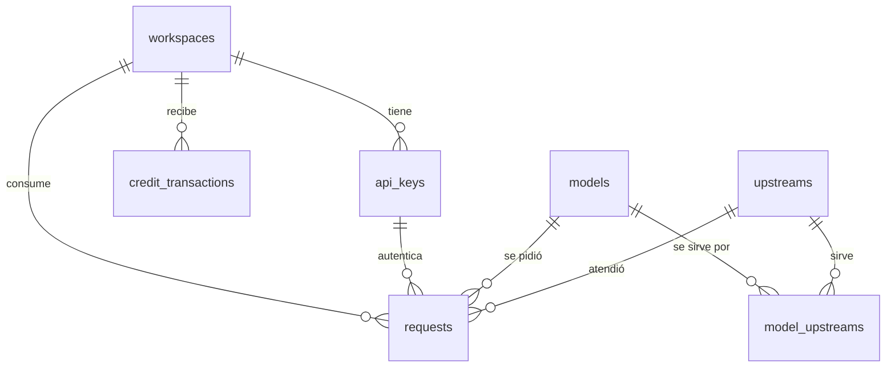

# 09 · Modelo de datos

Postgres en Neon, con esquema definido en Drizzle ([ADR-0006](./adr/0006-postgres-neon-drizzle.md)). Convenciones:

- Todo el dinero va en `bigint` con sufijo `_micro_usd` ([ADR-0007](./adr/0007-dinero-en-micro-dolares.md)).
- Los precios de catálogo van en µUSD **por 1M de tokens**.
- Las fechas son `timestamptz`.
- Los IDs internos son UUID v7, que se ordenan por tiempo. Los IDs públicos llevan prefijo (`req_…`).

## `workspaces`

Es el dueño del saldo y de las keys. En el MVP hay uno por usuario de Clerk ([ADR-0016](./adr/0016-workspace-dueno.md)).

| Columna | Tipo | Notas |
|---|---|---|
| `id` | uuid PK | |
| `clerk_user_id` | text, único, not null | Se crea de forma perezosa en el primer acceso al dashboard |
| `balance_micro_usd` | bigint, not null, default 0 | Desnormalizado. Puede ser negativo ([08](./08-creditos-y-pagos.md#el-saldo-puede-quedar-levemente-negativo)) |
| `rate_limit_rpm` | int, null | Override del rate limit. Null = valor global |
| `suspended_at` | timestamptz, null | Por contracargo o abuso. El gateway responde `403 account_suspended` |
| `deleted_at` | timestamptz, null | Cuando llega `user.deleted` de Clerk |
| `created_at`, `updated_at` | timestamptz | |

## `api_keys`

([05 · API keys](./05-api-keys.md))

| Columna | Tipo | Notas |
|---|---|---|
| `id` | uuid PK | |
| `workspace_id` | uuid FK → workspaces | |
| `name` | text, not null | |
| `hash` | text, único, not null | SHA-256 hex de la key completa |
| `hint` | text, not null | `wtf_4f8K…b3Zx` |
| `spend_limit_micro_usd` | bigint, null | Null = sin límite |
| `spent_micro_usd` | bigint, not null, default 0 | |
| `last_used_at` | timestamptz, null | |
| `created_at` | timestamptz | |
| `revoked_at` | timestamptz, null | Borrado suave |

Índices: único en `hash`; `(workspace_id, revoked_at)`.

## `models`

([06 · Catálogo](./06-catalogo-y-precios.md))

| Columna | Tipo | Notas |
|---|---|---|
| `id` | text PK | `anthropic/claude-haiku-4.5` |
| `name` | text | |
| `author` | text | `anthropic` |
| `description` | jsonb | `{ "en": "...", "es": "..." }` |
| `context_length` | int | |
| `max_output_tokens` | int, null | |
| `official_input_price_micro_usd` | bigint | Por 1M |
| `official_output_price_micro_usd` | bigint | Por 1M |
| `official_price_source_url` | text | |
| `official_price_verified_at` | date, null | Null mientras el precio sea de ejemplo o no se haya verificado en la página del autor ([ADR-0029](./adr/0029-catalogo-de-pruebas-inferhub.md)) |
| `discount_bps` | int, check 0–9999 | 9000 = 90% |
| `input_price_micro_usd` | bigint | **Derivado** al sincronizar: oficial × (10000 − bps) / 10000 |
| `output_price_micro_usd` | bigint | **Derivado** |
| `tags` | text[] | Validado contra el enum de tags en la app |
| `status` | enum `active \| hidden \| deprecated \| retired` | |
| `deprecated_at`, `retires_at` | date, null | |
| `created_at`, `updated_at` | timestamptz | |

El precio cheaptokens.wtf se guarda derivado para que el gateway no tenga que recalcularlo y para que sea consultable en SQL. La única fuente es la fórmula, que se aplica al sincronizar.

## `upstreams`

([07 · Upstreams](./07-upstreams.md))

| Columna | Tipo | Notas |
|---|---|---|
| `id` | text PK | `upstream-a` |
| `name` | text | |
| `base_url` | text | |
| `api_key_env` | text | **Nombre** de la env var, nunca el valor |
| `enabled` | boolean | |
| `created_at`, `updated_at` | timestamptz | |

## `model_upstreams`

| Columna | Tipo | Notas |
|---|---|---|
| `model_id` | text FK → models | PK compuesta |
| `upstream_id` | text FK → upstreams | PK compuesta |
| `upstream_model` | text | ID del modelo en el upstream |
| `cost_input_micro_usd` | bigint | Por 1M, lo que nos cobra |
| `cost_output_micro_usd` | bigint | Por 1M |
| `priority` | int | Menor = primero |
| `enabled` | boolean | Lo controla la sincronización |
| `ops_disabled_at` | timestamptz, null | **Interruptor de emergencia. La sincronización no lo toca** |
| `ops_disabled_reason` | text, null | |

## `requests`

Una fila por cada request que llegó a la etapa de elegir upstream. Los rechazos tempranos (401, 402, 403, 404, 429) no se guardan. **No se guarda contenido** ([ADR-0014](./adr/0014-no-guardar-contenido.md)).

| Columna | Tipo | Notas |
|---|---|---|
| `id` | uuid PK | Público como `req_<id>` y en `x-request-id` |
| `workspace_id` | uuid FK | |
| `api_key_id` | uuid FK | |
| `model_id` | text FK | |
| `upstream_id` | text FK, null | Null si ningún upstream respondió. **Interno, nunca se muestra al cliente** |
| `attempts` | smallint | Upstreams intentados |
| `stream` | boolean | |
| `status` | enum `success \| client_cancelled \| upstream_error \| upstream_timeout \| invalid_request` | |
| `http_status` | smallint | Lo que recibió el cliente |
| `error_code` | text, null | Nuestro código de error |
| `prompt_tokens` | int | |
| `completion_tokens` | int | |
| `cached_tokens` | int, null | Se guarda desde ya, aunque en el MVP no cambie el precio |
| `usage_estimated` | boolean | True si el upstream no reportó `usage` |
| `cost_micro_usd` | bigint | **Lo que se cobró** |
| `upstream_cost_micro_usd` | bigint | Lo que nos cuesta: `usage.cost` si el upstream lo reporta (InferHub sí), o el costo del mapeo |
| `official_cost_micro_usd` | bigint | Lo que habría costado al precio oficial (para el "ahorro") |
| `ttfb_ms` | int, null | Tiempo al primer byte |
| `latency_ms` | int | Duración total |
| `created_at` | timestamptz | |

Índices: `(workspace_id, created_at DESC)` para el dashboard; `(api_key_id, created_at DESC)`; `(upstream_id, created_at)` para la conciliación.

Crecimiento: es la tabla más grande. En la fase 2 se evalúa particionarla por mes y agregar una tabla de resumen diario por workspace y modelo para que el dashboard no recorra todas las filas.

## `credit_transactions`

Entradas de dinero y ajustes.

| Columna | Tipo | Notas |
|---|---|---|
| `id` | uuid PK | |
| `workspace_id` | uuid FK | |
| `type` | enum `topup \| refund \| adjustment` | |
| `amount_micro_usd` | bigint | Positivo en recargas, negativo en reembolsos y en algunos ajustes |
| `payment_provider` | text, null | `polar`, `paddle` o `stripe`. Null en ajustes manuales |
| `external_id` | text, único, null | ID del pago o del reembolso en el MoR, con prefijo del proveedor (`polar:…`). **Clave de idempotencia** |
| `note` | text, null | Obligatorio en `adjustment` |
| `created_at` | timestamptz | |

## Invariantes

1. **Saldo:** para cada workspace,
   `balance_micro_usd = Σ credit_transactions.amount_micro_usd − Σ requests.cost_micro_usd`.
   Un cron diario lo verifica y alerta si hay diferencia.
2. **Gasto de la key:** `api_keys.spent_micro_usd = Σ requests.cost_micro_usd` de esa key.
3. **Margen:** para todo `model_upstreams` habilitado, el precio cheaptokens.wtf ≥ costo × (1 + `MIN_MARGIN`). Lo garantiza la sincronización ([06](./06-catalogo-y-precios.md#margen-mínimo)).
4. **Movimientos atómicos:** todo cambio de saldo ocurre en la misma transacción que la fila (`requests` o `credit_transactions`) que lo justifica.
