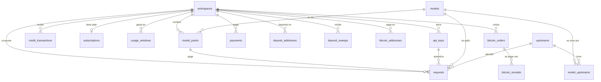

# 09 · Modelo de datos

Postgres en Neon, con esquema definido en Drizzle ([ADR-0006](./adr/0006-postgres-neon-drizzle.md)). Convenciones:

- Todo el dinero va en `bigint` con sufijo `_micro_usd` ([ADR-0007](./adr/0007-dinero-en-micro-dolares.md)).
- Los precios de catálogo van en µUSD **por 1M de tokens**.
- Las fechas son `timestamptz`.
- Los IDs internos son UUID v7, que se ordenan por tiempo. Los IDs públicos llevan prefijo (`req_…`).

## `workspaces`

Es el dueño del plan, del saldo y de las keys. En el MVP hay uno por usuario de Clerk ([ADR-0016](./adr/0016-workspace-dueno.md)).

| Columna | Tipo | Notas |
|---|---|---|
| `id` | uuid PK | |
| `clerk_user_id` | text, único, not null | Se crea de forma perezosa en el primer acceso al dashboard. En el modo de desarrollo es `dev:<nombre>` ([ADR-0050](./adr/0050-login-clerk-y-modo-desarrollo.md)) |
| `balance_micro_usd` | bigint, not null, default 0 | Saldo de créditos. Desnormalizado. Puede ser negativo ([08](./08-creditos-y-pagos.md#el-saldo-puede-quedar-levemente-negativo)) |
| `rate_limit_rpm` | int, null | Override del rate limit. Null = el del plan activo o, sin plan, el global |
| `overflow_mode` | enum `continue \| stop`, default `continue` | Qué pasa al llegar al límite del plan ([08](./08-creditos-y-pagos.md#orden-de-cobro-y-excedente)) |
| `overflow_packs`, `overflow_credits` | boolean, default true | Si el excedente usa paquetes y créditos |
| `overflow_cap_micro_usd` | bigint, default 25000000 | Tope mensual de créditos usados como excedente ($25) |
| `overflow_month` | date, null | Primer día del mes (UTC) al que corresponde `overflow_spent_micro_usd` |
| `overflow_spent_micro_usd` | bigint, default 0 | Créditos usados como excedente en ese mes. Otro mes cuenta como 0 |
| `suspended_at` | timestamptz, null | Por contracargo o abuso. El gateway responde `403 account_suspended` |
| `deleted_at` | timestamptz, null | Cuando llega `user.deleted` de Clerk |
| `created_at`, `updated_at` | timestamptz | |

## `api_keys`

([05 · API keys](./05-api-keys.md))

| Columna | Tipo | Notas |
|---|---|---|
| `id` | uuid PK | |
| `workspace_id` | uuid FK → workspaces | |
| `name` | text, not null | |
| `hash` | text, único, not null | SHA-256 hex de la key completa |
| `hint` | text, not null | `wtf_4f8K…b3Zx` |
| `spend_limit_micro_usd` | bigint, null | Null = sin límite |
| `spent_micro_usd` | bigint, not null, default 0 | |
| `last_used_at` | timestamptz, null | |
| `billing_source` | enum `plan_then_prepaid \| plan_only \| prepaid_only`, default `plan_then_prepaid` | De dónde cobra ([05](./05-api-keys.md#fuente-de-cobro-y-modelos)) |
| `allowed_models` | text[], null | Null = todos los modelos |
| `expires_at` | timestamptz, null | Fin de la gracia de una key rotada. Null = no vence |
| `created_at` | timestamptz | |
| `revoked_at` | timestamptz, null | Borrado suave |

Índices: único en `hash`; `(workspace_id, revoked_at)`.

## `models`

([06 · Catálogo](./06-catalogo-y-precios.md))

| Columna | Tipo | Notas |
|---|---|---|
| `id` | text PK | `anthropic/claude-haiku-4.5` |
| `name` | text | |
| `author` | text | `anthropic` |
| `description` | jsonb | `{ "en": "...", "es": "..." }` |
| `context_length` | int | |
| `max_output_tokens` | int, null | |
| `official_input_price_micro_usd` | bigint | Por 1M |
| `official_output_price_micro_usd` | bigint | Por 1M |
| `official_price_source_url` | text | |
| `official_price_verified_at` | date, null | Null mientras el precio sea de ejemplo o no se haya verificado en la página del autor ([ADR-0029](./adr/0029-catalogo-de-pruebas-inferhub.md)) |
| `discount_bps` | int, check 0–9999 | 9000 = 90% |
| `input_price_micro_usd` | bigint | **Derivado** al sincronizar: oficial × (10000 − bps) / 10000 |
| `output_price_micro_usd` | bigint | **Derivado** |
| `tags` | text[] | Validado contra el enum de tags en la app |
| `status` | enum `active \| hidden \| deprecated \| retired` | |
| `deprecated_at`, `retires_at` | date, null | |
| `created_at`, `updated_at` | timestamptz | |

El precio cheapllm.wtf se guarda derivado para que el gateway no tenga que recalcularlo y para que sea consultable en SQL. La única fuente es la fórmula, que se aplica al sincronizar.

## `upstreams`

([07 · Upstreams](./07-upstreams.md))

| Columna | Tipo | Notas |
|---|---|---|
| `id` | text PK | `upstream-a` |
| `name` | text | |
| `base_url` | text | |
| `api_key_env` | text | **Nombre** de la env var, nunca el valor |
| `enabled` | boolean | |
| `created_at`, `updated_at` | timestamptz | |

## `model_upstreams`

| Columna | Tipo | Notas |
|---|---|---|
| `model_id` | text FK → models | PK compuesta |
| `upstream_id` | text FK → upstreams | PK compuesta |
| `upstream_model` | text | ID del modelo en el upstream |
| `cost_input_micro_usd` | bigint | Por 1M, lo que nos cobra |
| `cost_output_micro_usd` | bigint | Por 1M |
| `priority` | int | Menor = primero |
| `enabled` | boolean | Lo controla la sincronización |
| `ops_disabled_at` | timestamptz, null | **Interruptor de emergencia. La sincronización no lo toca** |
| `ops_disabled_reason` | text, null | |

## `requests`

Una fila por cada request que llegó a la etapa de elegir upstream. Los rechazos tempranos (401, 402, 403, 404, 429) no se guardan. **No se guarda contenido** ([ADR-0014](./adr/0014-no-guardar-contenido.md)).

| Columna | Tipo | Notas |
|---|---|---|
| `id` | uuid PK | Público como `req_<id>` y en `x-request-id` |
| `workspace_id` | uuid FK | |
| `api_key_id` | uuid FK | |
| `model_id` | text FK | |
| `upstream_id` | text FK, null | Null si ningún upstream respondió. **Interno, nunca se muestra al cliente** |
| `attempts` | smallint | Upstreams intentados |
| `stream` | boolean | |
| `status` | enum `success \| client_cancelled \| upstream_error \| upstream_timeout \| invalid_request` | |
| `http_status` | smallint | Lo que recibió el cliente |
| `error_code` | text, null | Nuestro código de error |
| `prompt_tokens` | int | |
| `completion_tokens` | int | |
| `cached_tokens` | int, null | Se guarda desde ya, aunque en el MVP no cambie el precio |
| `usage_estimated` | boolean | True si el upstream no reportó `usage` |
| `cost_micro_usd` | bigint | **Lo que se cobró**: el valor de uso a precio cheapllm.wtf |
| `plan_micro_usd` | bigint, default 0 | Parte que pagó el plan |
| `pack_micro_usd` | bigint, default 0 | Parte que pagó un paquete |
| `credits_micro_usd` | bigint, default 0 | Parte que pagaron los créditos. Es lo único que baja el saldo |
| `absorbed_micro_usd` | bigint, default 0 | Parte que nadie pagó: la absorbemos ([08](./08-creditos-y-pagos.md#orden-de-cobro-y-excedente)) |
| `pack_id` | uuid FK → model_packs, null | El paquete que pagó, si alguno |
| `upstream_cost_micro_usd` | bigint | Lo que nos cuesta: `usage.cost` si el upstream lo reporta (InferHub sí), o el costo del mapeo |
| `official_cost_micro_usd` | bigint | Lo que habría costado al precio oficial (para el "ahorro") |
| `ttfb_ms` | int, null | Tiempo al primer byte |
| `latency_ms` | int | Duración total |
| `created_at` | timestamptz | |

Índices: `(workspace_id, created_at DESC)` para el dashboard; `(api_key_id, created_at DESC)`; `(upstream_id, created_at)` para la conciliación.

CHECK `requests_cost_split_check`: `plan + pack + credits + absorbed = cost`. La migración `drizzle/0001_spotty_power_pack.sql` puso `credits_micro_usd = cost_micro_usd` en los requests anteriores, que se cobraban solo de créditos.

Crecimiento: es la tabla más grande. En la fase 2 se evalúa particionarla por mes y agregar una tabla de resumen diario por workspace y modelo para que el dashboard no recorra todas las filas.

## `credit_transactions`

Entradas de dinero y ajustes.

| Columna | Tipo | Notas |
|---|---|---|
| `id` | uuid PK | |
| `workspace_id` | uuid FK | |
| `type` | enum `topup \| refund \| adjustment \| purchase` | `purchase`: un plan pagado con el saldo, en negativo ([ADR-0058](./adr/0058-deposito-por-cuenta-y-saldo.md)) |
| `amount_micro_usd` | bigint | Positivo en recargas, negativo en reembolsos y en algunos ajustes |
| `payment_provider` | text, null | `polar`, `paddle` o `stripe`. Null en ajustes manuales |
| `external_id` | text, único, null | ID del pago o del reembolso en el MoR, con prefijo del proveedor (`polar:…`). **Clave de idempotencia** |
| `note` | text, null | Obligatorio en `adjustment` |
| `created_at` | timestamptz | |

## `subscriptions`

El plan vigente del workspace ([ADR-0049](./adr/0049-suscripcion-con-limites.md)). Una fila por workspace; los cobros quedan en `payments`.

| Columna | Tipo | Notas |
|---|---|---|
| `id` | uuid PK | |
| `workspace_id` | uuid FK, único | |
| `plan_id` | text | `plus`, `pro` o `max` (`src/lib/billing/plans.ts`) |
| `status` | enum `active \| past_due \| canceled` | Solo `active` da límites |
| `current_period_start`, `current_period_end` | timestamptz | El plan vale hasta `current_period_end` |
| `cancel_at_period_end` | boolean, default false | Sin uso con pago por adelantado ([ADR-0058](./adr/0058-deposito-por-cuenta-y-saldo.md)) |
| `next_plan_id` | text, null | Sin uso con pago por adelantado |
| `payment_provider` | text | El del último pago |
| `external_id` | text, único, null | El del último pago |
| `created_at`, `updated_at` | timestamptz | |

## `usage_windows`

Lo usado del plan en la ventana de 5 horas y en la semana.

| Columna | Tipo | Notas |
|---|---|---|
| `workspace_id` | uuid FK | PK compuesta |
| `kind` | enum `five_hour \| week` | PK compuesta |
| `started_at` | timestamptz | El primer request que cobró del plan en esta ventana |
| `resets_at` | timestamptz | `started_at` + 5 h o 7 días. Si ya pasó, la ventana cuenta como vacía y el siguiente cobro la reabre |
| `used_micro_usd` | bigint, default 0 | Valor de uso que pagó el plan |

## `model_packs`

Uso prepagado de un modelo, con bono y vencimiento.

| Columna | Tipo | Notas |
|---|---|---|
| `id` | uuid PK | |
| `workspace_id` | uuid FK | |
| `model_id` | text FK → models | |
| `paid_micro_usd` | bigint | Lo que se pagó |
| `granted_micro_usd` | bigint | Lo pagado × 1.2 |
| `balance_micro_usd` | bigint, check entre 0 y `granted` | Lo que queda |
| `expires_at` | timestamptz | 90 días después de la compra |
| `created_at` | timestamptz | |

Índice: `(workspace_id, model_id, expires_at)`.

## `payments`

Cada cobro: depósitos y planes (y los paquetes de cuando se vendían). El saldo sigue saliendo de `credit_transactions`. **El dinero que entra son solo los depósitos:** un plan pagado con saldo (`payment_provider = balance`) reparte dinero que ya había entrado.

| Columna | Tipo | Notas |
|---|---|---|
| `id` | uuid PK | |
| `workspace_id` | uuid FK | |
| `kind` | enum `topup \| subscription \| pack` | |
| `amount_micro_usd` | bigint | |
| `item` | text, null | `plan_id` en planes, `model_id` en paquetes |
| `payment_provider` | text | `usdc-solana`, `usdc-base` o `usdc-dev` en un depósito; `balance` en un plan pagado con saldo ([ADR-0058](./adr/0058-deposito-por-cuenta-y-saldo.md)) |
| `external_id` | text, único | **Clave de idempotencia.** En un depósito, `<red>:<transacción del barrido>`; en una compra con saldo, `balance:<uuid>` |
| `receipt_url` | text, null | La transacción del barrido en Solscan o Basescan |
| `created_at` | timestamptz | |

Índices: único en `external_id`; `(workspace_id, created_at DESC)`.

## `deposit_addresses`

La dirección de depósito de un workspace en cada red ([ADR-0058](./adr/0058-deposito-por-cuenta-y-saldo.md)). No guarda ningún secreto: la llave sale de `CRYPTO_DEPOSIT_SEED` y del id del workspace.

| Columna | Tipo | Notas |
|---|---|---|
| `workspace_id` | uuid FK | PK compuesta |
| `network` | text | PK compuesta. `solana` o `base` |
| `address` | text | Única por red |
| `unswept_micro_usd` | bigint, default 0, check ≥ 0 | USDC que había sin barrer la última vez que se miró |
| `watch_until` | timestamptz, null | Mientras no pase, el cron la revisa en cada corrida: su dueño abrió el depósito hace poco |
| `checked_at` | timestamptz, null | La última vez que se leyó su saldo en la cadena. Las demás se revisan por turnos, de la más vieja a la más nueva |
| `created_at` | timestamptz | |

Índices: único en `(network, address)`; `(network, checked_at NULLS FIRST)`; `(network, watch_until)`.

## `deposit_sweeps`

Un barrido: la transacción que mueve el USDC de una dirección de depósito a la wallet principal. Se guarda antes de enviarla y el saldo se acredita cuando queda confirmada. USDC tiene 6 decimales: 1 unidad = 1 µUSD.

| Columna | Tipo | Notas |
|---|---|---|
| `id` | uuid PK | |
| `workspace_id` | uuid FK | |
| `network` | text | `solana`, `base` o `dev` (el depósito simulado de desarrollo local) |
| `address` | text | La dirección de depósito barrida |
| `amount_micro_usd` | bigint, check > 0 | Lo que mueve, y lo que se acredita |
| `tx_id` | text | La firma en Solana o el hash en Base |
| `status` | enum `pending \| confirmed \| failed` | |
| `last_valid` | bigint | Hasta cuándo puede entrar: en Solana, la última altura de bloque válida; en Base, el `validBefore` de la autorización (segundos) |
| `auth_nonce` | text, null | Base: el nonce de la autorización EIP-3009 |
| `error` | text, null | `expired`, `reverted` o el error del RPC al enviarla |
| `created_at`, `settled_at` | timestamptz | |

Índices: único en `(network, tx_id)`; único en `(network, address)` entre los `pending` (un solo barrido en vuelo por dirección); `(workspace_id, created_at DESC)`; los que no están `confirmed`, por `(network, settled_at DESC)`.

## `deposit_scans`

Quién está barriendo cada red: una fila por red con `leased_until`. Un solo proceso a la vez, para no cruzar los nonces del relayer de Base.

## `bitcoin_addresses`

Una dirección de Bitcoin de un workspace ([ADR-0063](./adr/0063-pagos-en-bitcoin.md)): la de recibir número `derivation_index` de `CRYPTO_BITCOIN_XPUB`. No guarda ningún secreto.

| Columna | Tipo | Notas |
|---|---|---|
| `network` | text | PK compuesta. `mainnet`, `testnet4` o `signet` |
| `derivation_index` | integer, check ≥ 0 | PK compuesta. `m/84'/<moneda>'/<cuenta>'/0/<índice>`, en orden y sin saltos |
| `address` | text | Única |
| `workspace_id` | uuid FK | |
| `used_at` | timestamptz, null | El primer pago visto. Desde entonces el workspace cotiza en otra dirección; esta se sigue revisando |
| `watch_until` | timestamptz, null | Mientras no pase, el cron la lee en cada corrida: hay una cotización o un pago reciente |
| `checked_at` | timestamptz, null | La última vez que se leyó en la cadena |
| `created_at` | timestamptz | |

Índices: único en `address`; único en `(network, workspace_id)` entre las que no tienen `used_at` (a lo más una sin usar por workspace); `(workspace_id, network)`; `(network, watch_until)`; `(network, checked_at NULLS FIRST)`.

## `bitcoin_orders`

Una cotización en Bitcoin: el precio queda fijo hasta `expires_at` (15 minutos). Una nueva del workspace reemplaza a la anterior.

| Columna | Tipo | Notas |
|---|---|---|
| `id` | uuid PK | |
| `workspace_id` | uuid FK | |
| `network`, `address` | text | Dónde se paga |
| `intent` | enum `topup \| plan` | Créditos o un plan |
| `plan_id`, `plan_mode` | text, null | Con `plan`: el plan y lo que iba a pasar (`activate`, `extend`, `upgrade`). Un CHECK los exige juntos |
| `amount_micro_usd` | bigint | Lo cotizado. Para un plan, lo que faltaba después del saldo |
| `amount_sats` | bigint | Lo que hay que enviar, hacia arriba |
| `rate_micro_usd` | bigint | µUSD por BTC |
| `expires_at` | timestamptz | |
| `replaced_at` | timestamptz, null | Otra cotización la reemplazó |
| `outcome` | text, null | `plan`, `balance` o `replaced` |
| `settled_at` | timestamptz, null | Cuándo quedó resuelta. Un plan sin resolver espera otro pago a la misma cotización |
| `created_at` | timestamptz | |

Índices: `(workspace_id, created_at DESC)`; `(address, created_at DESC)`.

## `bitcoin_receipts`

Una salida de una transacción que paga una dirección nuestra. El precio queda fijo al verla; se acredita una sola vez, con las confirmaciones.

| Columna | Tipo | Notas |
|---|---|---|
| `id` | uuid PK | |
| `workspace_id` | uuid FK | |
| `network`, `address` | text | |
| `order_id` | uuid FK, null | La última cotización de esa dirección; null si llegó sin ninguna |
| `txid`, `vout` | text, integer | `bitcoin:<txid>:<vout>` es el `external_id` del pago |
| `amount_sats` | bigint | |
| `rate_micro_usd` | bigint | El precio aplicado |
| `rate_source` | text | `quote` (llegó a tiempo y no pasa de lo cotizado + 10 %) o `market` (el del momento en que se vio) |
| `amount_micro_usd` | bigint, check ≥ 0 | Lo que se acredita: los sats a ese precio, hacia abajo |
| `status` | enum `seen \| credited \| dropped` | `dropped`: desapareció sin confirmarse por 30 minutos |
| `seen_at` | timestamptz | Cuándo se vio; la hora del bloque si ya estaba confirmado |
| `block_height` | integer, null | |
| `missing_since` | timestamptz, null | Sin confirmar y ya no aparece en la red |
| `credited_at`, `created_at` | timestamptz | |

Índices: único en `(network, txid, vout)`; `(workspace_id, seen_at DESC)`; `order_id`; las `seen`, por `(network, address)`.

## Invariantes

1. **Saldo:** para cada workspace,
   `balance_micro_usd = Σ credit_transactions.amount_micro_usd − Σ requests.credits_micro_usd`.
   Un cron diario lo verifica y alerta si hay diferencia (`src/lib/billing/reconcile.ts`).
2. **Gasto de la key:** `api_keys.spent_micro_usd = Σ requests.cost_micro_usd` de esa key.
3. **Paquetes:** para cada paquete, `model_packs.balance_micro_usd = granted_micro_usd − Σ requests.pack_micro_usd` de ese paquete. Lo verifica la misma conciliación.
4. **Reparto:** en cada request, `plan + pack + credits + absorbed = cost`. Lo garantiza un CHECK.
5. **Margen:** para todo `model_upstreams` habilitado, el precio cheapllm.wtf ≥ costo × (1 + `MIN_MARGIN`). Lo garantiza la sincronización ([06](./06-catalogo-y-precios.md#margen-mínimo)).
6. **Movimientos atómicos:** todo cambio de saldo, de paquete o de ventana ocurre en la misma transacción que la fila (`requests`, `credit_transactions` o `payments`) que lo justifica.
