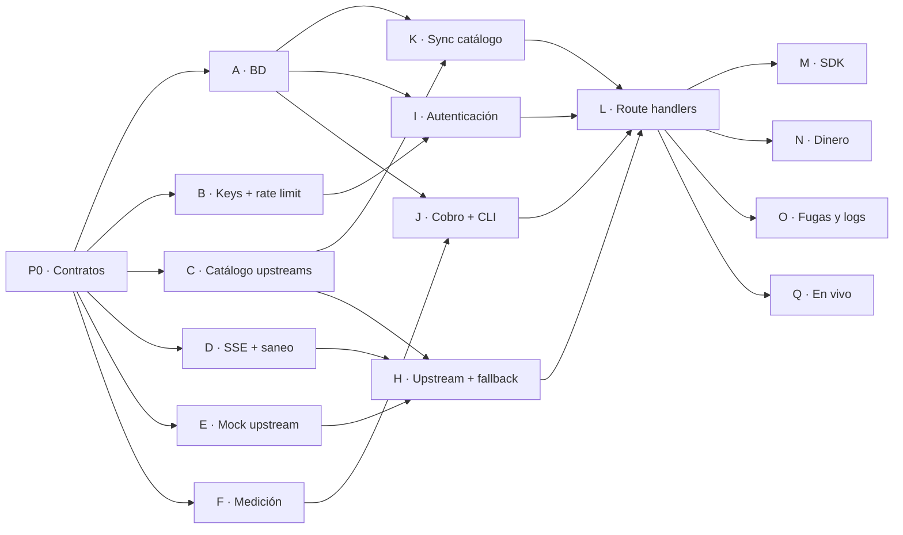

# 15 · Plan: gateway con InferHub

> **Estado (2026-11-11): implementado.** Las olas 0 a 4 están integradas en `main`, con revisión de cada paquete y una verificación final. El gateway funciona de punta a punta contra el upstream simulado y contra InferHub de verdad. Lo que salió al construir está en [§8](#8-lo-que-salió-al-construir). Falta P2: la key de InferHub solo para cheaptokens.wtf.

## Objetivo

Un request hecho con el SDK oficial de OpenAI a `http://localhost:3000/v1/chat/completions`, con una key `wtf_`:

1. llega a InferHub con el modelo del mapeo y un tope de precio;
2. vuelve, con y sin streaming, **sin ningún rastro del upstream**;
3. queda cobrado en µUSD en Postgres, con el saldo y el gasto de la key cuadrados.

**Fuera de este plan:**

- el dashboard (necesita Clerk);
- los pagos (bloqueados hasta que un MoR apruebe, [ADR-0019](./adr/0019-merchant-of-record.md));
- el deploy en Vercel, Neon y Upstash;
- `/v1/messages`.

Los créditos de prueba se cargan con un script.

## 0. Qué se probó con InferHub

El 2026-11-10, con la cuenta que ya usan las herramientas de código del dueño, por menos de $0.001 en total. El detalle está en [ADR-0028](./adr/0028-inferhub-upstream-de-pruebas.md) y las respuestas reales en `tests/fixtures/inferhub/`.

| Probado | Resultado |
|---|---|
| Chat sin stream, con stream y con tools | ✅ Funciona en Qwen 3.8 Flash, DeepSeek V4.1 Flash, GLM 5.3 Flash y Claude Haiku 4.5 |
| `usage` para cobrar | ✅ Siempre viene, con `cost`. ⚠️ En streaming llega dos veces |
| Costo real | Lo decide el vendedor que toque, no el ask mínimo. Qwen 3.8 Flash costó el 11.7% del oficial y Claude Haiku 4.5 el 19.9% |
| Tope de precio por request | ✅ `x-max-input-price` / `x-max-output-price`. Si nadie entra, `402 no_provider_under_bid` y no se cobra |
| Cobro mínimo | $0.00001 (10 µUSD) por request facturado |
| Fugas del upstream | Headers `x-inferhub-*`, `request_id`, `error.source` y el nombre del proveedor real en errores `400` |
| Fidelidad del `usage` | ⚠️ Depende del vendedor: uno estimó tokens con caracteres ÷ 4, otro cobró 51 tokens de salida con `max_tokens: 10` |
| Endpoint de saldo | ❌ No existe. La conciliación es manual |

## 1. Prerrequisitos

| # | Qué | Quién | Bloquea |
|---|---|---|---|
| P1 | **Inicializar git** en el proyecto y hacer el commit inicial. Opcional: un repo privado en GitHub | Dueño (o Claude, con su visto bueno) | **Todo.** Los ejecutores trabajan en worktrees y los revisores revisan diffs |
| P2 | **Una key de InferHub solo para cheaptokens.wtf**, en `.env.local` como `UPSTREAM_INFERHUB_API_KEY`. Si InferHub permite ponerle límite, de unos $5 | Dueño | Solo las pruebas en vivo (ola 4). Antes se trabaja con el upstream simulado |
| P3 | ~~Las decisiones D1–D3~~ | — | **Resuelto:** quedaron en los ADRs 0029, 0030 y 0031 ([§2](#2-decisiones)) |
| P4 | Base de datos local: **PGlite**, sin cuenta ni Docker (Docker y `psql` no están instalados) ([ADR-0032](./adr/0032-postgres-node-postgres-y-pglite.md)) | Nadie | No bloquea |
| P5 | Clerk, Upstash, Neon y Vercel | — | **No hacen falta en este plan** |

## 2. Decisiones

Se propusieron con este plan y quedaron como ADRs el 2026-11-10. Si el dueño cambia alguna, se escribe un ADR nuevo que la reemplace.

| # | Decisión | ADR | La usa |
|---|---|---|---|
| D1 | **Catálogo de pruebas:** Claude Haiku 4.5 mapeado a `ant/claude-haiku-4-5` y con el descuento bajado de 90% a 78%, más Qwen 3.8 Flash, DeepSeek V4.1 Flash y GLM 5.3 Flash como `hidden`, con 85% | [0029](./adr/0029-catalogo-de-pruebas-inferhub.md) | C |
| D2 | **Cobro mínimo de 10 µUSD** ($0.00001) por request que genera salida, porque InferHub nos cobra ese mínimo | [0030](./adr/0030-cobro-minimo-por-request.md) | F |
| D3 | **`reasoning_content` pasa al cliente,** en `message` y en `delta` | [0031](./adr/0031-reasoning-content-pasa-al-cliente.md) | D |
| D4 | **node-postgres en todos lados y PGlite en desarrollo y pruebas** (reemplaza a ADR-0006) | [0032](./adr/0032-postgres-node-postgres-y-pglite.md) | P0, A |
| D5 | **El gateway es una función con dependencias inyectadas,** sin importar `next/*` | [0033](./adr/0033-gateway-con-dependencias-inyectadas.md) | P0, L |
| D6 | **Construcción por olas** con planificador, ejecutores y revisores | [0034](./adr/0034-construccion-por-olas.md) | Todos |

Las cifras del catálogo de pruebas (oficial, costo del mapeo y descuento máximo con 10% de margen) están en ADR-0029.

## 3. Cómo se ejecuta

### Roles

| Rol | Qué hace | Qué no hace |
|---|---|---|
| **Planificador** | Abre una tarea por paquete con su especificación de [§4](#4-olas-y-paquetes), lanza cada ola cuando la anterior está integrada y escribe los ADRs cuando una decisión cambia | No escribe código |
| **Ejecutor** | Implementa **un** paquete en su propio worktree y rama. Termina con `pnpm check` verde y las pruebas del paquete | No toca archivos de otro paquete ni los contratos de la ola 0. No cambia docs de decisiones |
| **Revisor** | Revisa el diff contra la especificación del paquete y el [checklist](#5-checklist-de-revisión). Recibe el diff y la especificación, **no** el razonamiento del ejecutor | No arregla: devuelve "aprobado" o una lista de cambios |
| **Integrador** | Hace merge en el orden de la ola y corre `pnpm check` en `main` después de cada uno | — |

### Reglas

- **Un archivo pertenece a un solo paquete por ola.** La columna "Archivos" de cada paquete es exclusiva.
- **La ola 0 la hace un solo ejecutor:** define los contratos para que los paralelos no choquen.
- **Una ola empieza cuando la anterior está integrada** y `pnpm check` pasa en `main`.
- **Si una decisión de los docs no funciona en la práctica,** el ejecutor para y lo reporta. El planificador decide y escribe el ADR. El código nunca diverge en silencio de los docs.
- **Next 16 no es el que conoce el modelo:** todo ejecutor que toque `src/app/` lee antes la guía correspondiente en `node_modules/next/dist/docs/` (route handlers, `after()`, `use cache`) y la cita en su resumen.
- **Ronda máxima de revisión: 2.** Si sigue con cambios, sube al planificador.
- **Pruebas en vivo contra InferHub** solo con `INFERHUB_LIVE=1`, con `qwen/qwen3.8-flash` y `reasoning_effort: "none"`. El tope de todo el plan es $1. Lo esperado es menos de $0.05.

### Tamaño

17 paquetes: 1 + 6 + 4 + 1 + 5. La ola 4 sumó R, la página `/docs` en inglés y español, a pedido del dueño. Las olas 1, 2 y 4 corren en paralelo.

## 4. Olas y paquetes



### Ola 0 · Contratos (1 ejecutor)

**P0 · Contratos y dependencias**

- **Archivos:** `package.json`, `src/lib/env.ts`, `src/lib/gateway/types.ts`, `src/lib/gateway/handler.ts` (solo la firma), `src/lib/db/types.ts`, `src/lib/rate-limit/types.ts`, `.env.example`.
- **Dependencias:** `drizzle-orm`, `drizzle-kit`, `pg`, `@electric-sql/pglite`, `zod`, `server-only`. En desarrollo: `openai`.
- **Decisiones que aplica:**
  - **Driver:** node-postgres en todos lados ([ADR-0032](./adr/0032-postgres-node-postgres-y-pglite.md)).
  - **`src/lib/gateway/` no importa `next/*`, React, Clerk ni diccionarios.** El route handler es un adaptador delgado que le pasa todo por inyección ([ADR-0033](./adr/0033-gateway-con-dependencias-inyectadas.md)):

```ts
// src/lib/gateway/handler.ts
export async function handleChatCompletion(req: Request, deps: GatewayDeps): Promise<Response>;

export interface GatewayDeps {
  db: Db;
  rateLimiter: RateLimiter;
  catalog: CatalogSnapshot;            // modelos + mapeos, cacheado 60 s
  fetch: typeof fetch;                 // para el mock
  after: (task: () => Promise<void>) => void;
  now: () => number;
  log: Logger;                         // sin bodies ni Authorization
  env: { isProduction: boolean };
}
```

- **Tipos centrales** en `types.ts`:
  - `UpstreamTarget`: `upstreamId`, `baseUrl`, `apiKey`, `upstreamModel`, `costInputPer1M`, `costOutputPer1M` (bigint, µUSD) y `sendsPriceCap`.
  - `Usage`: `promptTokens`, `completionTokens`, `cachedTokens`, `upstreamCostMicroUsd` (bigint o null) y `estimated`.
  - `GatewayErrorCode`: los 12 códigos de [04](./04-api.md#errores).
  - `UpstreamFailure`: red, timeout de conexión o de primer byte, o HTTP con `status` y `code` (para distinguir `no_provider_under_bid`).
- **`env.ts`:** valida con zod `DATABASE_URL`, `UPSTREAM_INFERHUB_API_KEY` (opcional fuera de producción), `UPSTREAM_MOCK_BASE_URL` (solo fuera de producción) y `INTERNAL_REVALIDATE_SECRET`.
- **Hecho cuando:** `pnpm check` pasa y no hay lógica, solo tipos y firmas. **El revisor de P0 es el más estricto del plan:** todo lo demás depende de esto.

### Ola 1 · Piezas puras (6 en paralelo)

**A · Esquema y base de datos**

- **Archivos:** `src/lib/db/schema.ts`, `src/lib/db/client.ts`, `drizzle.config.ts`, `drizzle/` (migración inicial), `tests/helpers/db.ts`, `tests/unit/db.test.ts`.
- **Lee:** [09 · Modelo de datos](./09-modelo-de-datos.md), [ADR-0032](./adr/0032-postgres-node-postgres-y-pglite.md), [ADR-0007](./adr/0007-dinero-en-micro-dolares.md).
- **Hecho cuando:**
  - Están todas las tablas de 09, con sus enums, el check de `discount_bps`, los índices y los UUID v7.
  - `tests/helpers/db.ts` crea una base PGlite en memoria con las migraciones aplicadas, en menos de 1 s por test.
  - Para desarrollo hay un comando que levanta PGlite con protocolo Postgres (`pglite-socket` o equivalente), así `next dev` usa el mismo `DATABASE_URL` que usaría Neon.
  - **Si `pglite-socket` no funciona, el ejecutor para y lo reporta:** el plan B es una rama de desarrollo en Neon, y esa cuenta la crea el dueño.

**B · API keys y rate limit**

- **Archivos:** `src/lib/api-keys/*`, `src/lib/rate-limit/memory.ts`, `tests/unit/api-keys.test.ts`, `tests/unit/rate-limit.test.ts`.
- **Lee:** [05 · API keys](./05-api-keys.md), [ADR-0027](./adr/0027-formato-api-keys-wtf.md), [ADR-0017](./adr/0017-rate-limit-upstash.md).
- **Hecho cuando:**
  - Existen `generateKey()` (53 caracteres, CRC32 en base62), `validateFormat()` (sin red), `hashKey()` (SHA-256 hex) e `hint()`.
  - Las pruebas cubren: un carácter cambiado falla el checksum, el largo es fijo y el alfabeto es base62.
  - Hay un rate limiter en memoria, de ventana deslizante, con `retryAfterS`. El de Upstash queda para el plan de deploy.

**C · Catálogo de upstreams**

- **Archivos:** `catalog/upstreams.ts`, `catalog/models.ts` (solo los cambios de D1), `src/lib/catalog/schema.ts` (zod), `src/lib/catalog/validate.ts`, `tests/unit/catalog.test.ts`.
- **Lee:** [06 · Catálogo](./06-catalogo-y-precios.md), [07 · Upstreams](./07-upstreams.md), [ADR-0028](./adr/0028-inferhub-upstream-de-pruebas.md), [ADR-0029](./adr/0029-catalogo-de-pruebas-inferhub.md).
- **Hecho cuando:**
  - El catálogo de [ADR-0029](./adr/0029-catalogo-de-pruebas-inferhub.md) está mapeado a `inferhub` y a `mock`.
  - La validación de margen advierte fuera de producción y falla en producción. La sincronización rechaza `mock` en producción.
  - Los tags calculados son correctos y no hay alias de InferHub: todo `upstreamModel` tiene la forma `prefijo/modelo`.
  - Los modelos `hidden` no aparecen en `/models`.
  - **Las capturas cambian solo por el 78% de Haiku:** se regeneran con `pnpm test:e2e:update` y el revisor las mira una por una.

**D · SSE, saneo y errores**

- **Archivos:** `src/lib/gateway/sse.ts`, `src/lib/gateway/sanitize.ts`, `src/lib/gateway/errors.ts`, `tests/unit/gateway/sse.test.ts`, `tests/unit/gateway/sanitize.test.ts`.
- **Lee:** [04 · API](./04-api.md), [07 › Ocultar el upstream](./07-upstreams.md#ocultar-el-upstream), `tests/fixtures/inferhub/`.
- **Hecho cuando:**
  - El parser es incremental y aguanta chunks partidos a mitad de línea y a mitad de un carácter UTF-8.
  - Todo comentario sale como `: keep-alive`.
  - La whitelist aplica a la respuesta, al chunk y a `usage`, y deja pasar `reasoning_content` ([ADR-0031](./adr/0031-reasoning-content-pasa-al-cliente.md)).
  - Los errores salen en formato OpenAI, sin `source` ni nombres de proveedor.
  - Con los fixtures reales: los dos `usage` del stream salen como uno; `publisher_400` sale sin `Qwencloud` ni `request_id`; y nada de `response-headers.txt` sobrevive.

**E · Upstream simulado**

- **Archivos:** `scripts/mock-upstream.ts`, `tests/helpers/mock-upstream.ts`, `tests/unit/mock-upstream.test.ts`.
- **Lee:** [07 › Tests automáticos](./07-upstreams.md#tests-automáticos-el-upstream-simulado).
- **Hecho cuando:**
  - Hay un servidor `node:http` compatible con OpenAI que se usa como script y como helper (`startMockUpstream()` en un puerto libre).
  - Se configura por headers `x-mock-*`: latencia al primer byte, número de chunks, `usage` ausente, `429`, `5xx`, `401`, `402` (con y sin `no_provider_under_bid`), `404`, `400`, corte a mitad del stream y error con HTTP 200.
  - **Por defecto imita a InferHub:** dos chunks de `usage`, `usage.cost`, `request_id`, `error.source` y headers `x-inferhub-*`.
  - Registra los requests que recibe (headers incluidos), para verificar el tope de precio y el `model` reescrito.

**F · Medición**

- **Archivos:** `src/lib/gateway/metering.ts`, `tests/unit/gateway/metering.test.ts`.
- **Lee:** [06 › Costo de un request](./06-catalogo-y-precios.md#costo-de-un-request), [ADR-0013](./adr/0013-medicion-con-usage-upstream.md), [ADR-0030](./adr/0030-cobro-minimo-por-request.md).
- **Hecho cuando:**
  - Existen funciones puras para:
    - extraer el `usage` (gana el último chunk que trae `cost`, y se combinan los tokens);
    - convertir USD a µUSD hacia arriba, sin pasar por float para el redondeo (`0.00061484904` → 615);
    - calcular el costo del cliente con `ceil` y el mínimo de 10 µUSD cuando hubo salida, y el costo oficial sin mínimo;
    - estimar con caracteres ÷ 4 cuando no hay `usage`.
  - Las pruebas cubren los bordes: 0 tokens, `usage` ausente y montos enormes en bigint.

### Ola 2 · Ensamble de piezas (4 en paralelo)

**H · Upstream y fallback**

- **Archivos:** `src/lib/gateway/upstream-fetch.ts`, `src/lib/gateway/select-upstream.ts`, `tests/unit/gateway/fallback.test.ts`.
- **Depende de:** C, D, E.
- **Hecho cuando:**
  - Los timeouts son de 10 s para conectar, 60 s al primer byte y 180 s para modelos `reasoning`, configurables.
  - Se fuerza `include_usage` y se mandan `x-max-input-price` / `x-max-output-price` cuando `sendsPriceCap`.
  - Se intentan como máximo 3 upstreams, con la tabla de fallback de [07](./07-upstreams.md#selección-y-fallback).
  - `402 no_provider_under_bid` hace fallback sin alerta crítica, y otro `402` la dispara.
  - No hay fallback después del primer chunk de datos.
  - Todo se prueba contra el mock.

**I · Autenticación**

- **Archivos:** `src/lib/gateway/authenticate.ts`, `tests/unit/gateway/authenticate.test.ts`.
- **Depende de:** A, B.
- **Hecho cuando:**
  - Se sigue el orden: `Bearer` → validación local → una sola query (key + workspace).
  - Una key revocada o inexistente da el mismo `401`. También están `403 key_limit_exceeded`, `403 account_suspended` y `402 insufficient_credits`.
  - Revocar una key hace fallar el request siguiente: no hay caché.

**J · Cobro y herramientas de línea de comandos**

- **Archivos:** `src/lib/billing/ledger.ts`, `scripts/keys-create.ts`, `scripts/credits-grant.ts`, `scripts/reconcile.ts`, los scripts `keys:create`, `credits:grant` y `reconcile` en `package.json`, y `tests/unit/billing.test.ts`.
- **Depende de:** A, F.
- **Hecho cuando:**
  - `chargeRequest()` hace todo en una transacción: inserta en `requests`, descuenta de `workspaces.balance_micro_usd` y suma a `api_keys.spent_micro_usd`.
  - `grantCredits()` inserta un `adjustment` con nota obligatoria.
  - `keys:create` crea el workspace de desarrollo si hace falta e imprime la key una sola vez.
  - `reconcile` verifica los invariantes 1 y 2 de [09](./09-modelo-de-datos.md#invariantes) y suma `upstream_cost_micro_usd` por upstream y por día, para comparar a mano con el dashboard de InferHub.

**K · Sincronización del catálogo**

- **Archivos:** `scripts/sync-catalog.ts`, `src/lib/gateway/catalog-snapshot.ts`, `src/app/api/internal/revalidate-catalog/route.ts`, el script `catalog:sync` y `tests/unit/sync-catalog.test.ts`.
- **Depende de:** A, C.
- **Hecho cuando:**
  - El upsert nunca borra, falla si desaparece un ID y nunca toca `ops_disabled_at`.
  - Al terminar llama a la revalidación con el secreto.
  - El snapshot en memoria dura 60 s, y `ops_disabled_at` saca un mapeo en 60 s o menos.

### Ola 3 · Route handlers (1 ejecutor)

**L · `/v1/chat/completions` y `/v1/models`**

- **Archivos:** `src/lib/gateway/handler.ts` (la implementación), `src/app/v1/chat/completions/route.ts`, `src/app/v1/models/route.ts`, `tests/unit/gateway/handler.test.ts`.
- **Depende de:** H, I, J, K.
- **Lee:** [03 › Flujo de un request](./03-arquitectura.md#flujo-de-un-request-al-gateway), [03 › Streaming](./03-arquitectura.md#streaming) y las guías de Next 16 sobre route handlers, `after()` y `use cache`.
- **Hecho cuando:**
  - Se sigue el flujo de 03 paso a paso.
  - El stream es passthrough, sin buffer, y no sale nada antes del primer chunk de datos.
  - Hay keep-alive y error a mitad del stream.
  - **Si el cliente se desconecta, el stream se drena en `after()`.**
  - Se cobra con `chargeRequest()` en `after()`.
  - Toda respuesta trae `x-request-id`, y los `id` tienen la forma `chatcmpl-req_…`.
  - Están `maxDuration = 800`, runtime de Node, `413` para bodies de más de 4.5 MB y sin CORS.
  - `/v1/models` es pública, se cachea con `cacheTag('catalog')` y no muestra los modelos `hidden`.

### Ola 4 · Pruebas de punta a punta y `/docs` (5 en paralelo)

Corren contra `next start` con PGlite y el mock, o llaman a `handleChatCompletion` directamente. Cada paquete agrega sus archivos en `tests/gateway/` y un script `test:gateway` (el primero que llega lo crea; los demás solo agregan archivos).

| Paquete | Prueba | Hecho cuando |
|---|---|---|
| **M · SDK** | El SDK oficial de OpenAI para JS, cambiando solo `baseURL` y `apiKey` | Funciona con y sin stream, con tools y con `stream_options.include_usage`. Los errores se leen como `APIError` con nuestro `code` |
| **N · Dinero** | 50 requests en paralelo contra el mock, 20% cancelados a la mitad | `reconcile` da 0 diferencias, el saldo puede quedar levemente negativo y luego todo da `402`, y revocar una key la corta en el siguiente request |
| **O · Fugas y logs** | Buscar el upstream en todo lo que recibe el cliente y en todo lo que se loguea | Ninguna respuesta, header ni error contiene `inferhub`, `x-inferhub`, `source`, `request_id` ni el UUID de un vendedor. Ningún log contiene la key, el prompt ni la respuesta |
| **Q · En vivo** | `INFERHUB_LIVE=1 pnpm test:live` con `qwen/qwen3.8-flash` | Stream, sin stream y tools funcionan contra InferHub de verdad. `upstream_cost_micro_usd` = `ceil(usage.cost × 10⁶)`. Gasta menos de $0.05 |

**R · `/[lang]/docs`** (agregado durante la ejecución): la página pública de docs/02 › Docs, en inglés y español, con el contenido de docs/04, el cobro mínimo de ADR-0030, la cancelación de ADR-0013 y `reasoning_content` de ADR-0031. Los ejemplos de SSE y la tabla de errores salen de las funciones del gateway, para que no se desfasen.

## 5. Checklist de revisión

Común a todos los paquetes. El revisor marca cada punto o explica por qué no aplica.

- [ ] `pnpm check` pasa, y las pruebas del paquete cubren el camino feliz **y** los fallos.
- [ ] El diff solo toca los archivos del paquete.
- [ ] **Dinero:** siempre bigint en µUSD y `ceil` donde lo dicen los docs. Los floats solo aparecen al leer `usage.cost`, y se convierten de inmediato. Nada de `toFixed()` ni `Number` para montos.
- [ ] **Fugas:** nada del upstream llega al cliente (IDs, headers, campos ni mensajes).
- [ ] **Logs:** sin `Authorization`, sin bodies y sin la key en claro.
- [ ] **Aislamiento:** `src/lib/gateway/` no importa `next/*`, React, Clerk ni diccionarios.
- [ ] **Contratos:** no cambió nada de P0. Si hacía falta, se pidió al planificador.
- [ ] **Docs:** lo implementado coincide con 03, 04, 07 y 09. Si no, está reportado.
- [ ] **Next 16:** si tocó `src/app/`, cita la guía de `node_modules/next/dist/docs/` que usó.

## 6. Terminado

Verificado el 2026-11-11 sobre el `main` integrado (verificación final con Opus 5.5 y repetición del planificador):

- [x] **Los paquetes de la ola 4 pasan.** `pnpm test:gateway`: 459 pruebas. La prueba en vivo (Q) pasa contra InferHub: sin stream, con stream y tools.
- [x] **El SDK de OpenAI funciona cambiando solo `base_url` y `api_key`**, con y sin streaming, incluyendo tools. Probado con el SDK de JS (15/15 casos en `next dev` y `next start`). El de Python no se probó.
- [x] **La conciliación da 0 de diferencia** después de 50 streams en paralelo con 20% cancelados, contra `next start` con PGlite. Antes del arreglo del pool había 401 y 502 falsos; ahora son 50 de 50.
- [x] **Revocar una key hace fallar el request siguiente** (`401`, también con stream).
- [x] **`ops_disabled_at` mueve el tráfico al mock en 45 s**, y `catalog:sync` no lo revierte. Probado con un InferHub simulado.
- [x] **Hay una prueba automática de fugas:** `tests/gateway/leaks.test.ts` recorre todos los escenarios del mock, con y sin stream. El revisor comprobó que falla al dejar pasar un header, un campo, un ID o un comentario SSE del upstream.
- [x] **`pnpm check` y `pnpm test:e2e` pasan** (1,111 unitarias, 459 del gateway, build y 70 e2e). Las capturas que cambiaron son las del descuento de Haiku, las nuevas de `/docs` y las del link a Docs en el header y el footer (paquete R).
- [x] **El roadmap ([11](./11-roadmap.md)) marca lo que se cerró.**

## 7. Después de este plan

- **Dashboard:** keys, saldo y uso. Necesita la instancia de Clerk del dueño.
- **Deploy:** Vercel Pro, Neon, Upstash y los dominios ([12 #4](./12-preguntas-abiertas.md#4-registrar-cheaptokenswtf)).
- **Pagos:** solo con la aprobación por escrito del MoR ([12 #2](./12-preguntas-abiertas.md#2-aprobación-por-escrito-de-un-mor)).
- **Prueba de fidelidad de InferHub,** antes de considerarlo para producción ([ADR-0028](./adr/0028-inferhub-upstream-de-pruebas.md#consecuencias)).
- **`/v1/messages`:** InferHub ya lo expone, así que la fase 2 (Claude Code) sería un adaptador más que un upstream nuevo.

## 8. Lo que salió al construir

### Quién hizo qué

| Rol | Modelo | Trabajo |
|---|---|---|
| Planificador e integrador | Opus 5.5 | El plan, los contratos de la ola 0, las instrucciones de cada paquete, los merges, las decisiones de integración y las verificaciones puntuales |
| Ejecutores | GPT 6.1 Sol con Codex | A, B, D, E, F, H, I, J, K, L, M, N, O y Q, y todas sus rondas de cambios |
| Ejecutores | Opus 5.5 | C (catálogo, con textos en inglés y español) y R (`/docs` bilingüe) |
| Revisores y verificación final | Opus 5.5 | Una revisión por paquete, sin ver el razonamiento del ejecutor, y la verificación final del sistema integrado |

Codex pasó de 29% a 30% de su cuota semanal en todo el plan.

### Lo que encontraron las revisiones

- **Fugas en los mensajes de error (D, tres rondas).** El filtro dejaba pasar IDs del backend de InferHub, segmentos del UUID del vendedor, IPs, IPv6, `host:puerto` e IDs con prefijo (`alicn/glm-5`). Al corregirlo con límites de palabra se reabrieron nombres pegados (`InferHubError`, `openai2`). La regla final: el borde de un nombre solo excluye minúsculas, y los decimales, las rutas de `param` y los tipos MIME se conservan.
- **`finish_reason` delata al proveedor** (`end_turn` es de Anthropic, `MAX_TOKENS` de Gemini). Ahora se normaliza a los valores de OpenAI.
- **Salir de un stream antes del final lanzaba `AbortError`** (D y H). Abandonar la iteración nunca lanza.
- **Sin stream, un 200 sin `choices` o con `error` contaba como éxito** (H). Ahora hace fallback.
- **`credits:grant` creaba el workspace si no existía** (J): un typo acreditaba saldo a una cuenta nueva. Ahora solo `keys:create` crea workspaces.
- **Con timeout se descartaba el `usage` reportado** (L). Decisión: se cobra lo reportado y solo se estima si no llegó (docs/03 actualizado).
- **El chequeo de host usaba la URL que arma Next**, que fuera de Vercel es `localhost` (L). Ahora usa el header `Host`.

### Lo que salió al integrar

- **PGlite con protocolo de Postgres funciona con node-postgres:** no hizo falta el plan B con Neon ([ADR-0032](./adr/0032-postgres-node-postgres-y-pglite.md)).
- **Con `cacheComponents`, Next 16 rechaza `export const runtime` y `dynamic`** en el build. Node ya es el default.
- **El tope de precio y el mock:** el ask del mock ($0.01) era mayor que el costo del mock en el catálogo, así que el mock rechazaba todo con `no_provider_under_bid`. Hay una prueba de regresión.
- **El escenario del mock no llegaba a través del gateway:** el catálogo mapeaba el mock a `mock/ok`, y el `model` tiene prioridad sobre `x_mock`. Los mapeos del mock ahora usan el mismo ID del modelo.
- **Playwright tolera 1% de diferencia en píxeles:** un cambio de texto puede pasar con la captura vieja. Para cambios intencionales de texto, `--update-snapshots=all` sobre las páginas afectadas.

### Prueba en vivo contra InferHub

| Caso | Tokens (entrada / salida) | Cobrado | Costo upstream | Latencia |
|---|---|---|---|---|
| Qwen 3.8 Flash, sin stream | 30 / 1 | 10 µUSD | 10 µUSD | 1.0–2.6 s |
| Qwen 3.8 Flash, con stream | 30 / 1 | 10 µUSD | 10 µUSD | 1.0 s |
| DeepSeek V4.1 Flash, tools | 302 / 40 | 11 µUSD | 10 µUSD | 1.3 s |

**En los requests mínimos el margen es 0:** el mínimo que cobramos (ADR-0030) es igual al de InferHub. El margen aparece cuando la fórmula por token supera los 10 µUSD.

### Pendientes conocidos

- **P2:** la key de InferHub solo para cheaptokens.wtf. Las pruebas en vivo usaron la de las herramientas del dueño, por variable de entorno y sin guardarla en ningún archivo.
- **Rate limit en memoria:** es por instancia. Upstash llega con el plan de deploy.
- **`CodeBlock`:** el botón de copiar tapa el final de la primera línea en bloques con líneas largas (los ejemplos SSE de `/docs`).
- **Header en 360 px:** se desborda unos 40 px en las dos lenguas. Ya pasaba antes de este plan.
- **`hreflang`:** apunta a `/en` y `/es`, no a la ruta actual. Ya pasaba antes de este plan.
- **SDK de Python:** no está en las pruebas automáticas (sí el de JS).
